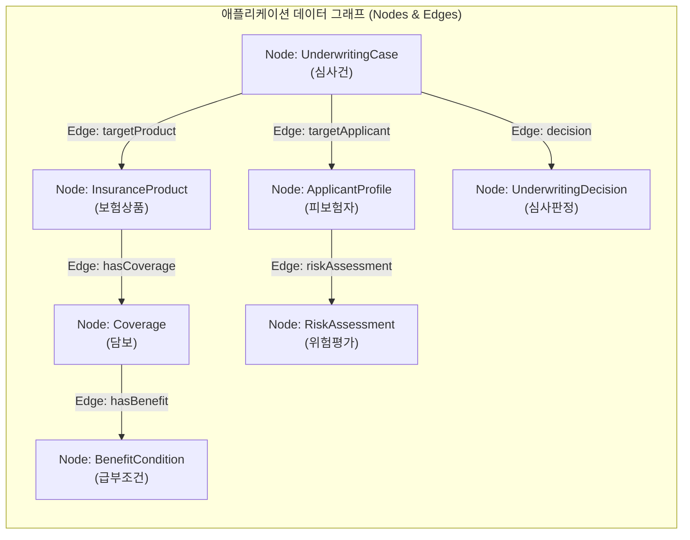
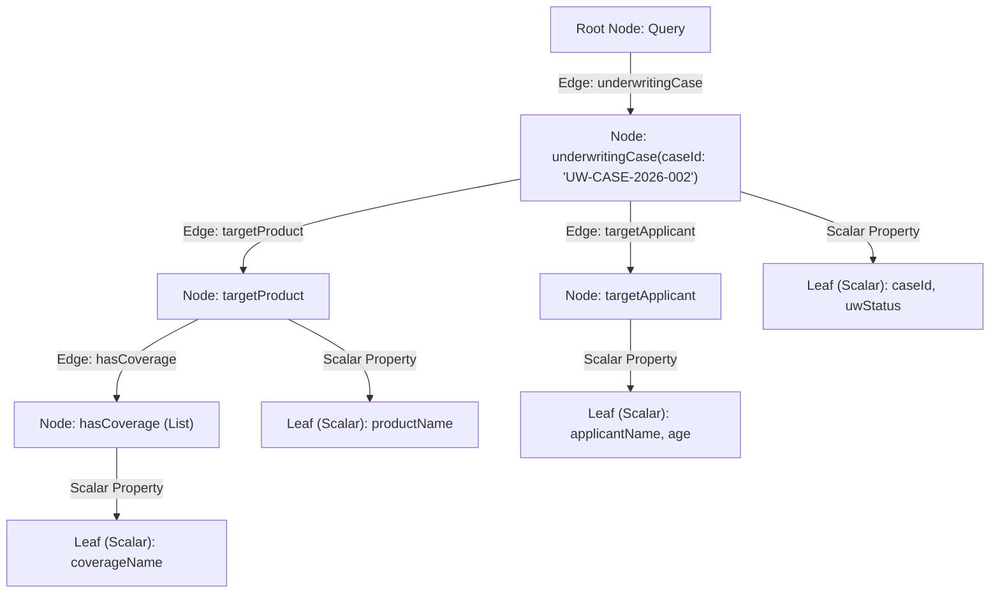
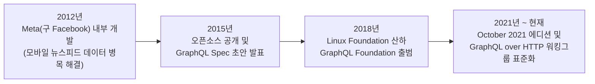
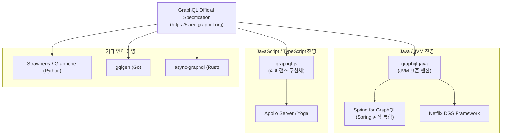
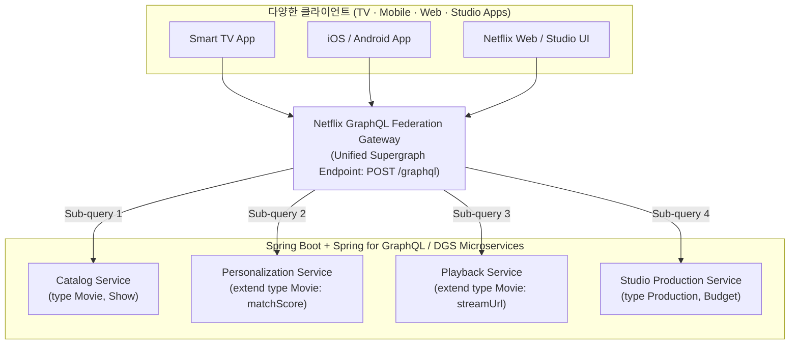

# Chapter 01. GraphQL의 소개

> **학습 목표**
> 1. GraphQL이라는 이름에서 **'Graph'**가 의미하는 바와 실제 그래프 자료구조와의 관계를 정확히 이해한다.
> 2. GraphQL의 **공식 표준(Specification)**이 어디에 정의되어 있으며 어떻게 관리·진화하는지 파악한다.
> 3. **Netflix**, **GitHub**, **Meta**, **Shopify** 등 글로벌 테크 기업들이 왜, 어떻게 GraphQL(특히 Spring Boot 기반 Federated GraphQL)을 사용하는지 아키텍처 수준에서 살펴본다.

---

## 1. 이름이 왜 GraphQL인가? 'Graph'와 무슨 관계인가?

**GraphQL**은 **Graph Query Language**의 약자입니다.  
처음 접하는 개발자들이 가장 많이 하는 질문 중 하나는 다음과 같습니다.

> *"GraphQL을 쓰려면 백엔드 데이터베이스로 Neo4j나 Amazon Neptune 같은 **Graph DB**를 써야 하나요?"*

결론부터 말하면 **전혀 아닙니다.** GraphQL은 특정 데이터베이스에 종속되지 않으며, RDBMS(PostgreSQL, Oracle, MySQL), NoSQL(MongoDB, Redis), 심지어 다른 REST 마이크로서비스나 외부 gRPC API 위에서도 동작하는 **API 계층의 쿼리 언어이자 런타임(Runtime)**입니다.

그렇다면 왜 하필 이름이 **Graph**QL일까요?

### 1.1 비즈니스 도메인의 멘탈 모델은 본질적으로 '그래프(Graph)'다

컴퓨터 과학에서 그래프(Graph)는 $G = (V, E)$, 즉 **정점(Vertex / Node)**과 이들을 연결하는 **간선(Edge / Relationship)**의 집합입니다.

우리가 다루는 모든 비즈니스 도메인 데이터를 생각해 봅시다.
- **이커머스 도메인**: `고객(User)`은 여러 `주문(Order)`을 생성하고, 각 `주문`은 여러 `상품(Product)`을 포함하며, 각 `상품`은 `리뷰(Review)`와 `판매자(Seller)`에 연결됩니다.
- **보험 언더라이팅 도메인**: `심사건(UnderwritingCase)`은 `청약 상품(InsuranceProduct)`과 `피보험자(ApplicantProfile)`를 연결하며, `청약 상품`은 여러 `담보(Coverage)`와 `급부 조건(BenefitCondition)`으로 이어집니다.

즉, 사람의 머릿속과 애플리케이션 메모리 상에서 도메인 모델은 표(Table)가 아니라 **서로 연결된 객체들의 그래프(Application Data Graph)**입니다.



### 1.2 SQL vs REST vs GraphQL의 데이터 바라보기

| 구분 | 데이터를 바라보는 관점 | 특징 및 한계 |
| :--- | :--- | :--- |
| **SQL** (Structured Query Language) | **테이블(Table)과 행/열(Row/Column)** | 정규화된 2차원 테이블들을 `JOIN`하여 평탄화된(Flat) 결과 집합(ResultSet)을 반환함. |
| **REST** (Representational State Transfer) | **개별 리소스 URI(Resource Endpoint)** | 그래프의 각 노드(`User`, `Product`, `Order`)를 독립된 URL(`/users/1`, `/products/5`)로 쪼개어 노출함. 노드 간 간선(Edge)을 따라가려면 클라이언트가 여러 번 HTTP 요청을 보내야 함. |
| **GraphQL** (Graph Query Language) | **정점(Object Type)과 간선(Field)** | 비즈니스 도메인 전체를 하나의 연결된 그래프(Schema)로 정의하고, 클라이언트가 루트 노드(`Query`)부터 원하는 간선(Field)을 따라가며 **부분 그래프(Subgraph / Tree)**를 한 번에 추출함. |

### 1.3 그래프 탐색(Graph Traversal)으로서의 GraphQL 쿼리

GraphQL 쿼리는 **"루트 노드에서 시작해 어떤 간선(Edge)을 타고 들어가 어떤 정점(Node)의 속성을 가져올 것인가"**를 선언하는 그래프 탐색 명세서입니다.



위 그래프 탐색을 그대로 텍스트로 옮긴 것이 바로 GraphQL 쿼리입니다:

```graphql
query GetUnderwritingSubgraph {
  underwritingCase(caseId: "UW-CASE-2026-002") {   # 1. Root에서 특정 심사건 노드로 진입
    caseId                                         # 2. 해당 노드의 스칼라 속성 선택
    uwStatus
    targetProduct {                                # 3. targetProduct 간선(Edge)을 따라 상품 노드로 이동
      productName
      hasCoverage {                                # 4. hasCoverage 간선을 따라 담보 노드 목록으로 이동
        coverageName
      }
    }
    targetApplicant {                              # 5. targetApplicant 간선을 따라 피보험자 노드로 이동
      applicantName
      age
    }
  }
}
```

> **핵심 요약**: GraphQL의 **Graph**는 데이터베이스 종류를 뜻하는 것이 아니라, **"비즈니스 도메인의 엔티티(Node)와 관계(Edge)를 그래프 형태로 모델링하고 탐색한다"**는 데이터 추상화 모델을 의미합니다.

---

## 2. GraphQL 표준(Specification)은 어디에 정의되어 있는가?

GraphQL은 특정 벤더의 독점 프레임워크나 라이브러리가 아니라, 엄격하게 문서화된 **오픈 표준 명세(Open Specification)**입니다.

### 2.1 GraphQL 표준의 역사와 거버넌스



1. **탄생 (2012년, Facebook)**: 스마트폰 보급 초기, Facebook이 모바일 앱을 HTML5 웹뷰에서 네이티브 iOS/Android 앱으로 재작성하면서 심각한 문제에 직면했습니다. 뉴스피드 하나를 그리기 위해 게시물, 작성자, 댓글, 좋아요, 친구 관계를 수십 번의 REST API로 호출하다 보니 모바일 네트워크 지연과 배터리 소모가 극심했고, 이를 해결하기 위해 Lee Byron, Dan Schafer, Nick Schrock이 GraphQL을 설계했습니다.
2. **오픈소스 및 스펙 공개 (2015년)**: React.js 컨퍼런스에서 외부에 처음 공개되었으며, 특정 언어에 종속되지 않도록 **공식 언어 명세서(Specification)**를 함께 발표했습니다.
3. **GraphQL Foundation 이관 (2018년 ~ 현재)**: 중립적인 거버넌스를 위해 **Linux Foundation** 산하의 **GraphQL Foundation**으로 지적재산권과 스펙 관리 권한이 이관되었습니다. 현재 Meta, Netflix, GitHub, AWS, Apollo, Shopify, Intuit 등이 멤버로 참여하고 있습니다.

### 2.2 반드시 알아야 할 2가지 공식 표준 문서

GraphQL 표준은 크게 **언어/실행 엔진 표준**과 **HTTP 전송 표준** 두 가지로 나뉩니다.

#### ① GraphQL Specification (언어 및 실행 엔진 표준)
- **공식 URL**: [https://spec.graphql.org](https://spec.graphql.org)
- **GitHub 저장소**: [https://github.com/graphql/graphql-spec](https://github.com/graphql/graphql-spec)
- **정의하는 내용**:
  1. **Query Language (쿼리 문법)**: `query`, `mutation`, `subscription`, 프래그먼트(`fragment`), 변수(`$var`), 디렉티브(`@include`, `@skip`)의 문법(Grammar)과 렉서 토큰 규칙.
  2. **Type System & SDL (스키마 정의 언어)**: `scalar`, `type`, `interface`, `union`, `enum`, `input`, `directive`의 정의 규칙.
  3. **Introspection (인트로스펙션)**: `__schema`, `__type`, `__field` 등 스키마가 자기 자신의 구조를 반환하는 표준 메타 필드 규격.
  4. **Validation (유효성 검증 알고리즘)**: 실행 전에 클라이언트가 보낸 쿼리가 스키마에 부합하는지 검사하는 정적 검증 규칙(예: 존재하지 않는 필드 요청 거부, 인자 타입 불일치 거부).
  5. **Execution (실행 및 응답 포맷 규격)**: 필드 리졸버 실행 순서(Query는 병렬 가능, Mutation의 루트 필드는 순차 실행 보장), Null 전파(Null Bubbling) 규칙, 응답 JSON의 `data`, `errors`, `extensions` 최상위 키 규격.

#### ② GraphQL over HTTP Specification (HTTP 전송 표준)
- **공식 URL**: [https://graphql.github.io/graphql-over-http/draft/](https://graphql.github.io/graphql-over-http/draft/)
- **GitHub 저장소**: [https://github.com/graphql/graphql-over-http](https://github.com/graphql/graphql-over-http)
- **정의하는 내용**:
  - GraphQL 본래 스펙은 전송 계층(Transport Layer)에 중립적이었으나, 실무의 99%가 HTTP를 사용하므로 HTTP 요청/응답 규격을 표준화한 문서입니다.
  - 요청 본문 JSON 구조(`{"query": "...", "operationName": "...", "variables": {...}, "extensions": {...}}`)
  - `Content-Type: application/json` 및 `Accept: application/graphql-response+json` 미디어 타입과 HTTP 상태 코드 처리 기준을 정의합니다.

### 2.3 표준(Spec)과 언어별 구현체(Implementation)의 관계

표준 문서(`spec.graphql.org`)가 존재하기 때문에, 어떤 프로그래밍 언어를 쓰든 동일한 GraphQL 쿼리와 클라이언트 도구를 그대로 사용할 수 있습니다.



---

## 3. Netflix를 포함해서 GraphQL을 잘 사용하는 회사들은?

초기에는 프론트엔드 친화적인 스타트업 기술로 여겨졌으나, 현재는 **대규모 마이크로서비스(MSA)를 운영하는 빅테크 및 금융/커머스 엔터프라이즈의 표준 API 게이트웨이 아키텍처**로 자리 잡았습니다.

### 3.1 Netflix (넷플릭스): Spring Boot + Federated GraphQL의 대표 주자

Netflix는 전 세계에서 GraphQL과 **Java/Spring Boot 기반 GraphQL 생태계**에 가장 큰 영향을 미친 기업 중 하나입니다.

#### (1) 도입 배경: Falcor에서 Federated GraphQL로의 진화
- Netflix는 초기에 자체 개발한 JSON Graph 기술인 **Falcor**를 사용해 TV, 모바일, 웹 등 수천 종의 디바이스에 API를 제공했습니다.
- 그러나 Netflix 내부의 마이크로서비스가 수백~수천 개로 늘어나고, 컨슈머 스트리밍 앱뿐만 아니라 영화/시리즈 제작을 관리하는 **Netflix Studio Engineering**(수백 개의 복잡한 엔터프라이즈 도메인: 대본, 촬영 스케줄, 예산, 계약, VFX 등)이 확장되면서, 도메인 간 데이터를 유연하게 조합할 수 있는 **GraphQL Federation(연합 그래프)**을 전사 표준으로 채택했습니다.

#### (2) Netflix의 Federated GraphQL 아키텍처
Netflix는 모든 마이크로서비스 위에 하나의 거대한 통합 스키마(**Unified Supergraph**)를 노출하되, 실제 구현은 각 도메인 팀의 **Spring Boot 마이크로서비스(Subgraph / DGS)**가 나누어 담당하는 구조를 사용합니다.



#### (3) Netflix가 오픈소스 생태계에 기여한 것: DGS와 Spring for GraphQL 통합
- Netflix는 Java/Spring Boot 환경에서 GraphQL 서버를 쉽게 개발하기 위해 **Netflix DGS (Domain Graph Service) Framework**를 오픈소스로 공개했습니다.
- 이후 VMware(현 Broadcom)의 Spring 팀과 `graphql-java` 창시자(Andi Marek)가 협력하여 **Spring for GraphQL**을 출시했고, **2024년 Netflix DGS 팀과 Spring for GraphQL 팀이 공식 통합을 발표**하면서 현재 Netflix DGS는 내부적으로 **Spring for GraphQL 엔진 위에서 동작**하고 있습니다.
- 즉, 오늘 세미나에서 배우는 **Spring for GraphQL(`@QueryMapping`, `@SchemaMapping`, `@BatchMapping`)**은 Netflix가 대규모 프로덕션에서 검증한 아키텍처와 직결되어 있습니다.

---

### 3.2 그 밖에 GraphQL을 핵심 인프라로 사용하는 글로벌/국내 기업들

| 기업명 | 주요 활용 영역 | 도입 이유 및 기술적 성과 |
| :--- | :--- | :--- |
| **Meta (Facebook & Instagram)** | 모바일 앱, 웹 뉴스피드, 광고 관리자 전체 | GraphQL의 창시 기업. 수십억 사용자의 소셜 그래프(친구, 게시물, 댓글, 반응)를 모바일 환경에서 단일 왕복으로 렌더링. |
| **GitHub** | **GitHub Public API v4** 및 GitHub 웹 UI | 기존 REST API v3에서 PR 목록과 각 PR의 커밋 상태, 리뷰어, 이슈 라벨을 가져오려면 수십 번 호출해야 했던 문제를 GraphQL API v4로 해결. 외부 개발자에게 오픈된 가장 유명한 퍼블릭 GraphQL API. |
| **Shopify** | 글로벌 이커머스 Storefront API & Admin API | 수백만 가맹점의 상품, 재고, 장바구니, 결제(Checkout) API를 GraphQL로 제공. 초당 수십만 건의 블랙프라이데이 트래픽을 GraphQL로 처리하며, 2024년부터 REST Admin API를 공식 Deprecated 처리하고 GraphQL을 기본 표준으로 지정. |
| **Airbnb** | 숙소 검색, 예약, 호스트 관리 앱/웹 | 프론트엔드 엔지니어가 백엔드 API 변경을 기다리지 않고 스키마에서 필요한 필드를 조합해 UI 실험(A/B 테스트) 속도를 3배 이상 단축. |
| **PayPal** | 결제 체크아웃(Checkout) 및 가맹점 대시보드 | REST 시절 결제 완료까지 여러 API를 거치며 발생하던 네트워크 지연을 GraphQL 도입 후 줄여 결제 전환율(Conversion Rate)을 개선. |
| **국내 기업 (당근, 카카오, 토스, 올리브영, 무신사 등)** | 슈퍼앱 홈 화면 BFF, 어드민 워크벤치, 커머스 상세 페이지 | 여러 도메인(커뮤니티, 페이, 커머스, 광고)의 마이크로서비스 데이터를 한 화면에 모아 보여주는 **BFF(Backend For Frontend)** 및 내부 영업/운영 워크벤치에 적극 활용. |

---

## 4. 첫 번째 맛보기: `curl`과 Spring for GraphQL 동작 확인

이론을 살펴보았으니, 실제로 클라이언트가 `curl`로 GraphQL 서버에 요청을 보내고 Spring Boot 서버가 응답하는 가장 기본적인 흐름을 확인해 봅시다.

### 4.1 서버 측: Spring for GraphQL 컨트롤러 (`OntologyGraphQLController.java`)

본 프로젝트의 [`OntologyGraphQLController.java`](../backend/src/main/java/com/insure/ontology/graphql/OntologyGraphQLController.java)에는 다음과 같이 보험 상품을 조회하는 `@QueryMapping`이 선언되어 있습니다.

```java
@Controller
public class OntologyGraphQLController {

    private final ProductMockProvider productProvider;

    @QueryMapping
    public InsuranceProduct insuranceProduct(@Argument String productId) {
        return productProvider.getProductById(productId, "Query.insuranceProduct");
    }
}
```

### 4.2 클라이언트 측: `curl`을 이용한 GraphQL 호출 예제

GraphQL 요청은 기본적으로 `POST /graphql` 엔드포인트에 `{"query": "..."}` 형태의 JSON 바디를 전송합니다.

```bash
curl -X POST http://localhost:8080/graphql \
  -H "Content-Type: application/json" \
  -d '{
    "query": "query { insuranceProduct(productId: \"PROD-HLT-001\") { productId productName baseMonthlyPremium hasCoverage { coverageCode coverageName } } }"
  }'
```

### 4.3 서버 응답 JSON

클라이언트가 요청한 필드 구조(`productId`, `productName`, `baseMonthlyPremium`, `hasCoverage`)와 **100% 동일한 모양의 JSON**이 `data` 키 아래에 반환됩니다.

```json
{
  "data": {
    "insuranceProduct": {
      "productId": "PROD-HLT-001",
      "productName": "무배당 시그니처 100세 종합건강보험",
      "baseMonthlyPremium": 89000,
      "hasCoverage": [
        {
          "coverageCode": "COV-CANCER-01",
          "coverageName": "일반암진단비(특약)"
        },
        {
          "coverageCode": "COV-BRAIN-02",
          "coverageName": "뇌혈관질환진단비"
        },
        {
          "coverageCode": "COV-HEART-03",
          "coverageName": "허혈성심장질환진단비"
        }
      ]
    }
  }
}
```

---

> **다음 챕터 예고**: [Chapter 02. GraphQL의 핵심 특징과 장점](./02-graphql-features-and-pros.md)에서는 왜 GraphQL이 **Single Endpoint**를 사용하는지, 그리고 REST 대비 어떤 구조적 장점(Over-fetching/Under-fetching 해결, 타입 안정성, 부분 실패 처리 등)을 제공하는지 깊이 있게 살펴봅니다.
