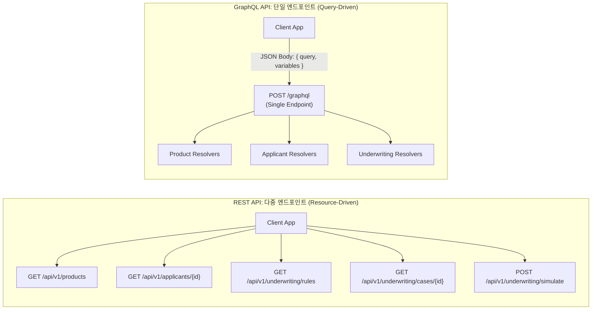
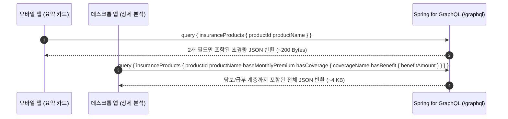
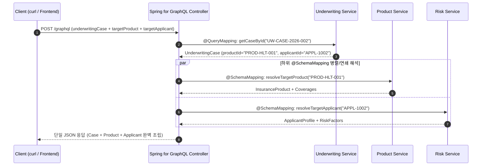

# Chapter 02. GraphQL의 핵심 특징과 장점

> **학습 목표**
> 1. GraphQL의 가장 큰 외형적 특징인 **Single Endpoint (`POST /graphql`)**가 REST의 다중 리소스 URI 방식과 어떻게 다른지 이해한다.
> 2. **Over-fetching**, **Under-fetching(Waterfall)**, **클라이언트 측 Join 복잡도** 문제를 GraphQL이 어떻게 해결하는지 다이어그램과 `curl` 예제로 확인한다.
> 3. 강력한 타입 시스템, Introspection, 부분 성공(`data` + `errors`) 등 실무 개발 생산성을 높여주는 장점들을 파악한다.

---

## 1. Single Endpoint (`POST /graphql`)

### 1.1 REST의 다중 엔드포인트 vs GraphQL의 단일 엔드포인트

REST API에서는 **"어떤 데이터가 필요한가"**를 **URL 경로(URI)**와 **HTTP 메서드(`GET`, `POST`, `PUT`, `DELETE`)**의 조합으로 표현합니다. 따라서 도메인 리소스와 화면 요구사항이 늘어날수록 서버의 엔드포인트 개수가 기하급수적으로 증가합니다.

반면 GraphQL은 원칙적으로 단 하나의 엔드포인트(**`POST /graphql`**)만 노출합니다. URL은 단지 GraphQL 실행 엔진으로 들어가는 **단일 출입구(Gateway)**일 뿐이며, **"무엇을 조회하거나 변경할 것인가"**는 HTTP 요청 본문(Body)에 담긴 **GraphQL Query/Mutation 문서**가 결정합니다.



### 1.2 왜 Single Endpoint가 강력한가?

1. **클라이언트 라우팅 및 API 관리 단순화**:
   - 프론트엔드는 수십 개의 엔드포인트 URL 상수를 관리할 필요 없이 오직 `/graphql` 하나만 바라봅니다.
2. **단일 요청 내 다중 루트 쿼리 결합 (Request Multiplexing)**:
   - 예를 들어 화면 초기 진입 시 **보험상품 목록(`insuranceProducts`)**, **고객 목록(`applicantProfiles`)**, **심사 규칙 목록(`underwritingRules`)**이 동시에 필요하다고 가정해 봅시다.
   - REST에서는 3번의 개별 HTTP 요청(`Promise.all`)을 보내야 하지만, GraphQL의 Single Endpoint에서는 하나의 쿼리 안에 3개의 루트 필드를 나란히 적어 **단 1회의 HTTP 요청**으로 모두 가져올 수 있습니다.

#### `curl` 예제: 단일 요청으로 서로 다른 3개 도메인 데이터 동시 조회
```bash
curl -X POST http://localhost:8080/graphql \
  -H "Content-Type: application/json" \
  -d '{
    "query": "query InitWorkbench { insuranceProducts { productId productName } applicantProfiles { applicantId applicantName } underwritingRules { ruleId ruleCode } }"
  }'
```

#### Spring for GraphQL 서버 처리 코드
서버에서는 클라이언트가 하나의 요청에 3개의 루트 필드를 묶어 보냈더라도, 각 루트 필드에 매핑된 `@QueryMapping` 메서드가 깔끔하게 분리되어 실행됩니다.

```java
@Controller
public class OntologyGraphQLController {

    @QueryMapping
    public List<InsuranceProduct> insuranceProducts(@Argument String category) {
        return productProvider.getAllProducts(category);
    }

    @QueryMapping
    public List<ApplicantProfile> applicantProfiles() {
        return riskProvider.getAllApplicants();
    }

    @QueryMapping
    public List<UnderwritingRule> underwritingRules(@Argument String riskCategory) {
        return uwProvider.getRules(riskCategory, "Query.underwritingRules");
    }
}
```

---

## 2. GraphQL의 핵심 장점들

### 2.1 장점 ①: Over-fetching (불필요한 데이터 과다 수신) 완벽 해결

**Over-fetching**이란 클라이언트가 화면에 표시할 필드는 2~3개뿐인데, 서버의 REST 엔드포인트가 고정된 DTO 전체(20~30개 필드)를 무조건 반환하여 네트워크 대역폭과 메모리, 직렬화 비용을 낭비하는 현상입니다.

- **모바일 목록 화면**: 상품 ID와 상품명만 필요함 (`productId`, `productName`)
- **PC 상세 화면**: 상품 기본 정보 + 담보 목록 + 급부 조건까지 모두 필요함

GraphQL에서는 서버 코드를 단 한 줄도 수정하지 않고, 클라이언트가 **Selection Set(`{ ... }`)**만 다르게 지정하여 필요한 필드만 정확히(Zero Over-fetching) 가져옵니다.



#### `curl` 비교 예제 (모바일용 최소 필드 요청)
```bash
curl -X POST http://localhost:8080/graphql \
  -H "Content-Type: application/json" \
  -d '{
    "query": "{ insuranceProducts { productId productName } }"
  }'
```

---

### 2.2 장점 ②: Under-fetching 및 네트워크 Waterfall 제거 (Client-Side Join 해방)

**Under-fetching**이란 한 화면을 그리기 위해 단일 엔드포인트의 응답만으로는 데이터가 부족하여, 첫 번째 응답에서 외래키(ID)를 꺼낸 뒤 두 번째, 세 번째 API를 연쇄적으로 호출(**Network Waterfall**)해야 하는 문제입니다.

예를 들어 **언더라이팅 심사건 상세 화면**을 그린다고 해봅시다.
- **REST 방식 (Network Waterfall 발생)**:
  1. `GET /cases/UW-CASE-2026-002` 호출 → 응답에서 `targetProductId: "PROD-HLT-001"`, `targetApplicantId: "APPL-1002"`, `matchedRuleIds: ["RULE-UW-01", "RULE-UW-02"]` 획득
  2. 획득한 ID들을 가지고 다시 `GET /products/PROD-HLT-001`, `GET /applicants/APPL-1002`, `GET /rules?ids=...` 호출
  3. 프론트엔드에서 각 응답을 조합(Client-Side Join)하고 로딩/에러 상태를 각각 관리해야 함

- **GraphQL 방식 (Server-Side Graph Resolution)**:
  - 클라이언트는 중첩 쿼리 단 1회만 전송합니다.
  - 하위 도메인 조립은 백엔드의 `@SchemaMapping` 리졸버가 내부 고속 네트워크(또는 메모리/배치)에서 처리하여 완성된 트리로 내려줍니다.



#### `curl` 예제: 3개 마이크로서비스 도메인을 관통하는 중첩 그래프 단건 호출
```bash
curl -X POST http://localhost:8080/graphql \
  -H "Content-Type: application/json" \
  -d '{
    "query": "query GetFullCase { underwritingCase(caseId: \"UW-CASE-2026-002\") { caseId uwStatus targetProduct { productName underwritingTrack } targetApplicant { applicantName riskAssessment { totalRiskScore riskGrade } } decision { decisionOutcome finalMonthlyPremium } } }"
  }'
```

---

### 2.3 장점 ③: 강력한 타입 시스템(Strongly Typed Schema)과 Contract-First 개발

GraphQL 서버는 반드시 **SDL(Schema Definition Language)**로 정의된 스키마를 가집니다.
- 모든 필드와 인자는 `String!`, `Int!`, `[Coverage!]!`처럼 명확한 타입과 **Null 허용 여부(`!`)**가 보장됩니다.
- 클라이언트가 스키마에 정의되지 않은 필드를 요청하거나 잘못된 타입의 인자를 보내면, 비즈니스 로직(Controller/Service)이 실행되기도 전에 GraphQL 엔진의 **Validation 단계**에서 즉시 명확한 에러 메시지와 함께 차단됩니다.
- 프론트엔드(`GraphQL Code Generator` 등)와 백엔드가 `schema.graphql` 파일을 **단일 계약서(Single Source of Truth)**로 삼아 동시에 개발을 진행할 수 있습니다.

---

### 2.4 장점 ④: Introspection(자기 성찰)과 살아있는 문서화 (Self-Documenting)

REST API에서는 Swagger(OpenAPI) 어노테이션을 개발자가 깜빡하고 누락하면 실제 코드와 API 문서가 불일치하는 현상(Documentation Drift)이 흔히 발생합니다.

반면 GraphQL은 **스키마 자체가 곧 실행 엔진의 설정**이며, 표준 스펙에 의해 **`__schema`**, **`__type`**이라는 **Introspection 쿼리**를 기본 지원합니다.
- 덕분에 **GraphiQL**, **Apollo Sandbox**, **Postman**, **IntelliJ GraphQL Plugin** 등이 서버에 접속하는 즉시 자동완성(Auto-complete), 타입 문서 조회, 쿼리 문법 검사를 실시간으로 제공합니다.

#### `curl` 예제: Introspection으로 서버에 정의된 모든 타입 목록 조회하기
```bash
curl -X POST http://localhost:8080/graphql \
  -H "Content-Type: application/json" \
  -d '{
    "query": "{ __schema { queryType { name } mutationType { name } types { name kind description } } }"
  }'
```

#### `curl` 예제: 특정 타입(`UnderwritingCase`)의 필드 명세만 Introspection으로 조회하기
```bash
curl -X POST http://localhost:8080/graphql \
  -H "Content-Type: application/json" \
  -d '{
    "query": "{ __type(name: \"UnderwritingCase\") { name description fields { name description type { name kind ofType { name kind } } } } }"
  }'
```

---

### 2.5 장점 ⑤: 부분 성공(Partial Success)과 장애 격리 (Fault Isolation)

복합 도메인 화면에서 3개의 마이크로서비스(상품, 고객위험, 심사규칙) 중 **부가적인 서비스 하나가 일시적 장애**를 겪는 상황을 가정해 봅시다.
- REST 기반의 일반 오케스트레이션 API에서는 하위 호출 중 하나라도 예외를 던지면 전체 API가 `500 Internal Server Error`로 실패하여 화면 전체가 하얗게 죽어버리기 쉽습니다.
- GraphQL은 **Nullable 필드에서 예외가 발생하면 해당 필드만 `null`로 처리하고, 성공한 나머지 `data`와 실패 원인을 담은 `errors` 배열을 한 응답에 함께 내려보내는 부분 성공(Partial Success)**을 표준으로 지원합니다.

```json
{
  "data": {
    "underwritingCase": {
      "caseId": "UW-CASE-2026-002",
      "uwStatus": "SUBSTANDARD_REVIEW",
      "targetProduct": {
        "productName": "무배당 시그니처 100세 종합건강보험"
      },
      "targetApplicant": null
    }
  },
  "errors": [
    {
      "message": "Risk Assessment Service 일시적 응답 지연",
      "locations": [{ "line": 7, "column": 5 }],
      "path": ["underwritingCase", "targetApplicant"],
      "extensions": {
        "classification": "INTERNAL_ERROR"
      }
    }
  ]
}
```
클라이언트는 `data.underwritingCase.targetProduct`를 통해 정상적인 화면 영역은 그대로 렌더링하고, `errors`의 `path`(`["underwritingCase", "targetApplicant"]`)를 참조해 고객 프로필 영역에만 "다시 시도" UI를 우아하게 표시할 수 있습니다.

---

### 2.6 장점 ⑥: `extensions` 필드를 활용한 메타데이터 및 데이터 리니지(Lineage) 확장

GraphQL 표준 응답 JSON은 최상위에 3개의 예약 키만 허용합니다:
1. `data`: 쿼리 실행 결과
2. `errors`: 실행 중 발생한 에러 목록 (에러가 없으면 생략)
3. `extensions`: 서버가 클라이언트나 모니터링 도구에 전달하고 싶은 **커스텀 메타데이터 영역** (트레이싱, 성능 지표, 데이터 계보 등)

본 워크스페이스의 [`OntologyGraphQLConfig.java`](../backend/src/main/java/com/insure/ontology/graphql/OntologyGraphQLConfig.java)에서는 `WebGraphQlInterceptor`를 통해 각 GraphQL 요청이 내부적으로 몇 번의 백엔드 호출(`totalBackendCalls`)을 일으켰고 어떤 온톨로지 속성(`ontologyLineage`)을 거쳤는지를 `extensions`에 자동으로 담아 반환합니다.

```java
@Bean
public WebGraphQlInterceptor ontologyLineageInterceptor(LineageTraceCollector lineageCollector) {
    return (request, chain) -> {
        lineageCollector.startRequest();
        return chain.next(request).map(response -> {
            List<LineageStep> steps = lineageCollector.finishRequest();
            return response.transform(builder -> builder.extensions(Map.of(
                    "ontologyLineage", steps,
                    "totalBackendCalls", steps.size()
            )));
        });
    };
}
```

---

## 3. REST vs GraphQL 핵심 비교 요약표

| 비교 항목 | REST API | GraphQL API |
| :--- | :--- | :--- |
| **엔드포인트 구조** | 리소스별 다중 URL (`GET /products`, `POST /orders`) | 단일 엔드포인트 (`POST /graphql`) |
| **데이터 형태 결정권** | **서버(Server-Driven)**: 컨트롤러가 반환하는 DTO 구조로 고정 | **클라이언트(Client-Driven)**: 쿼리의 Selection Set으로 필요한 필드만 지정 |
| **복합 도메인 조립** | 클라이언트가 여러 API를 호출해 직접 조립 (Under-fetching) | 서버의 `@SchemaMapping` 리졸버들이 그래프를 조립해 1회 응답 |
| **스키마 및 타입 검증** | 선택적 (OpenAPI/Swagger 별도 관리 필요) | **필수(Mandatory)**: SDL 스키마 없이는 서버 구동 불가, 런타임 자동 검증 |
| **버전 관리** | URL 버저닝 (`/api/v1/...`, `/api/v2/...`) | 필드 추가 및 `@deprecated` 디렉티브를 통한 **Versionless 진화** |
| **에러 표현 방식** | HTTP Status Code (`200`, `400`, `404`, `500`) | HTTP `200 OK` 본문 내 `data`와 `errors` 배열 분리 (부분 성공 지원) |

---

> **다음 챕터 예고**: [Chapter 03. GraphQL Schema 완벽 가이드](./03-graphql-schema-and-operations.md)에서는 GraphQL의 심장인 **Schema(SDL)**의 문법(`type`, `input`, `query`, `mutation`, `directive`)을 하나씩 해부하고, 실전 `curl` + Spring for GraphQL 코드로 Query와 Mutation을 작성하는 방법을 다룹니다.
