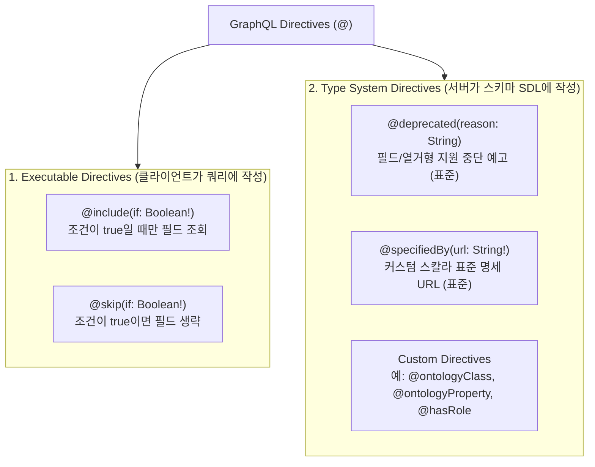
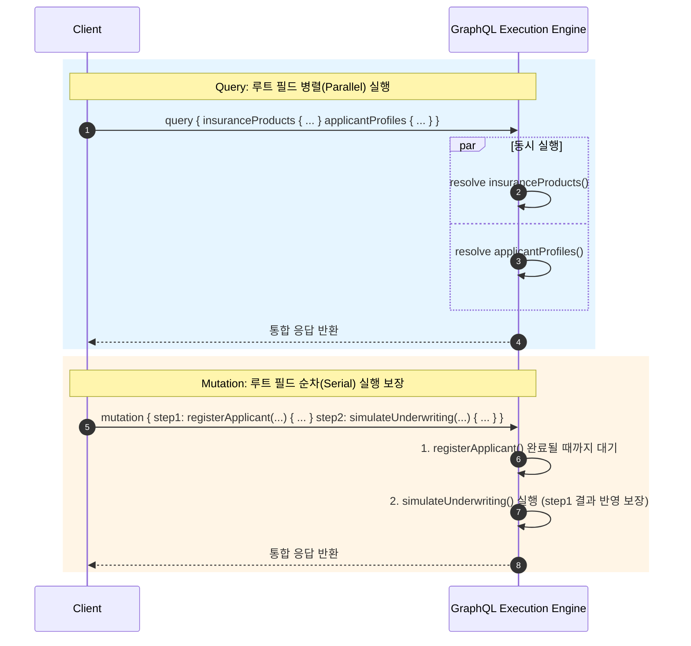

# Chapter 03. GraphQL Schema 완벽 가이드 (`type`, `input`, `query`, `mutation`, `directive`)

> **학습 목표**
> 1. GraphQL **SDL(Schema Definition Language)**의 5대 핵심 요소인 **`type`**, **`input`**, **`query`**, **`mutation`**, **`directive`**의 문법과 설계 의도를 완벽히 이해한다.
> 2. Nullability(`!`)와 배열(`[T!]!`)의 조합 규칙, 그리고 왜 `type`과 `input`이 엄격히 분리되어 있는지 파악한다.
> 3. `curl`과 **Spring Boot (Spring for GraphQL)** 코드를 통해 실전 **Query**와 **Mutation**(Variables, Aliases, Fragments, Directives 활용 포함)을 직접 구현하고 호출한다.

---

## 1. GraphQL SDL(Schema Definition Language) 전체 구조 한눈에 보기

GraphQL에서 **스키마(`*.graphqls` 또는 `schema.graphql`)**는 단순한 문서가 아니라, 서버가 제공할 수 있는 데이터 그래프의 **구조적 헌법(Contract)**입니다. Spring for GraphQL은 기본적으로 `src/main/resources/graphql/` 경로의 스키마 파일을 읽어 런타임 와이어링(`RuntimeWiring`)을 수행합니다.

```mermaid
classDiagram
    class Schema {
        +Query query
        +Mutation mutation
        +Subscription subscription
    }
    class Query {
        +underwritingCase(caseId: ID!) UnderwritingCase
        +insuranceProducts(category: String) List~InsuranceProduct~
    }
    class Mutation {
        +simulateUnderwriting(input: UnderwritingSimulationInput!) UnderwritingCase!
    }
    class UnderwritingCase {
        <<type (Output Object)>>
        +ID! caseId
        +String! uwStatus
        +InsuranceProduct! targetProduct
        +ApplicantProfile! targetApplicant
        +UnderwritingDecision! decision
    }
    class UnderwritingSimulationInput {
        <<input (Input Object)>>
        +ID! productId
        +String! applicantName
        +Int! age
        +Boolean! isSmoker
        +List~String~ riskFactorCodes
    }
    class Directive {
        <<@directive>>
        +@deprecated(reason: String)
        +@include(if: Boolean!)
        +@skip(if: Boolean!)
        +@ontologyClass(...)
        +@ontologyProperty(...)
    }

    Schema --> Query : 읽기 진입점
    Schema --> Mutation : 쓰기 진입점
    Query --> UnderwritingCase : 반환 (Output)
    Mutation --> UnderwritingSimulationInput : 인자로 수신 (Input)
    Mutation --> UnderwritingCase : 반환 (Output)
    UnderwritingCase ..> Directive : 메타데이터/실행제어 부착
```



---

## 2. 핵심 구성요소 ①: Scalar, Nullability(`!`), 그리고 `type` (Object Type)

### 2.1 기본 스칼라(Built-in Scalars)와 커스텀 스칼라

그래프 탐색의 끝단(Leaf Node)에 위치하는 더 이상 하위 필드로 쪼개지지 않는 원시 값들을 **Scalar**라고 합니다.

| 스칼라 타입 | 설명 | Java / Spring 매핑 타입 |
| :--- | :--- | :--- |
| **`Int`** | 부호 있는 32비트 정수 (`-2^31` ~ `2^31 - 1`) | `int`, `Integer` |
| **`Float`** | 부호 있는 배정밀도 부동소수점 실수 (IEEE 754) | `double`, `Double`, `float`, `Float` |
| **`String`** | UTF-8 문자열 | `String` |
| **`Boolean`** | `true` 또는 `false` | `boolean`, `Boolean` |
| **`ID`** | 고유 식별자. 직렬화 시 문자열(`String`)로 전송되나 인간이 읽는 텍스트가 아닌 **식별자(Key)**임을 명시 (클라이언트 캐시 키로 활용됨) | `String`, `Long`, `UUID` |
| **Custom Scalar** | `scalar DateTime`, `scalar BigDecimal`, `scalar JSON` 등 (`graphql-java-extended-scalars` 라이브러리로 손쉽게 등록 가능) | `OffsetDateTime`, `BigDecimal`, `Map<String, Object>` |

### 2.2 Nullability(`!`)와 리스트(`[...]`)의 4가지 조합

GraphQL은 기본적으로 모든 필드가 **Nullable(Null 허용)**입니다. 절대 `null`이 될 수 없는 필드에만 느낌표(**`!`**)를 붙여 **Non-Null** 계약을 맺습니다. 특히 배열(`[...]`)과 결합될 때 다음 4가지 조합의 차이를 정확히 구분해야 합니다.

| SDL 표기 | 리스트 자체 `null` 가능? | 리스트 내부 원소 `null` 가능? | 허용되는 JSON 예시 | 거부되는(에러) JSON 예시 |
| :--- | :---: | :---: | :--- | :--- |
| `[String]` | O | O | `null`, `[]`, `["A", null]` | - |
| `[String!]` | O | **X** | `null`, `[]`, `["A", "B"]` | `["A", null]` (원소 null 불가) |
| `[String]!` | **X** | O | `[]`, `["A", null]` | `null` (리스트 자체 null 불가) |
| **`[String!]!`** | **X** | **X** | `[]`, `["A", "B"]` | `null`, `["A", null]` (둘 다 불가, **실무 최다 사용**) |

> **실무 팁**: 리스트 필드를 정의할 때는 프론트엔드에서 불필요한 null 체크를 줄이기 위해 빈 배열(`[]`)을 기본 반환하도록 하고 **`[Coverage!]!`** 형태를 사용하는 것이 가장 안전합니다. 단, 하위 마이크로서비스 장애 시 부분 성공(Partial Success)으로 격리하고 싶은 연관 객체 필드는 의도적으로 `!`를 빼서 Nullable(`targetApplicant: ApplicantProfile`)로 설계하기도 합니다.

### 2.3 `type` (Object Type): 도메인 노드의 정의

`type`은 서버가 클라이언트에게 **반환(Output)**할 수 있는 도메인 객체(Node)와 그 간선(Field)들을 정의합니다.  
일반 필드뿐만 아니라 **필드 자체에 인자(Field Arguments)**를 받을 수도 있습니다.

```graphql
"""보험상품(InsuranceProduct) 도메인 객체 타입"""
type InsuranceProduct {
  productId: ID!
  productName: String!
  productCategory: String!
  underwritingTrack: String!
  baseMonthlyPremium: Int!
  maxEntryAge: Int!
  "포함된 담보 목록 (선택적으로 민감 위험 카테고리로 필터링 가능)"
  hasCoverage(riskCategory: String): [Coverage!]!
}
```

---

## 3. 핵심 구성요소 ②: `input` (Input Object Type)

### 3.1 `input`이란 무엇인가?

Query나 Mutation에 전달할 파라미터가 2~3개를 넘어가거나 계층 구조를 가질 때, 이를 하나의 구조체로 묶어 전달하기 위해 사용하는 **입력 전용 타입**입니다.

```graphql
"""언더라이팅 시뮬레이션 요청 입력 객체"""
input UnderwritingSimulationInput {
  productId: ID!
  applicantName: String!
  age: Int!
  gender: String! = "F"          # 기본값(Default Value) 지정 가능!
  occupationName: String!
  occupationGrade: Int! = 1
  isSmoker: Boolean!
  bmi: Float!
  riskFactorCodes: [String!]!
}
```

### 3.2 왜 GraphQL은 `type`을 그대로 입력으로 쓰지 않고 굳이 `input`을 분리했을까?

세미나에서 자주 나오는 핵심 질문입니다. Java에서는 하나의 DTO 클래스를 요청과 응답에 공용으로 쓰기도 하는데, 왜 GraphQL 스펙은 `type`을 인자 타입으로 쓰는 것을 문법적으로 금지하고 `input`을 강제할까요?

1. **출력 `type`의 필드는 '인자(Argument)'와 '리졸버(계산된 필드)'를 가질 수 있기 때문**:
   - 예를 들어 `type User` 안에 `profileImage(size: Int = 100): String`이라는 동적 계산 필드가 있거나, 양방향 순환 참조(`User -> Order -> User`)가 있을 수 있습니다. 이런 구조는 클라이언트가 JSON 값으로 직렬화해 올려보내는 입력값으로 성립할 수 없습니다.
2. **입출력 생명주기와 보안(Mass Assignment 방지)의 분리**:
   - 출력 타입(`type UnderwritingCase`)에는 서버가 생성하는 `caseId`, `decision`, `matchedRules` 같은 읽기 전용 필드가 포함됩니다. 입력 전용인 `input UnderwritingSimulationInput`을 분리함으로써 클라이언트가 조작해서는 안 되는 필드를 스키마 수준에서 원천 차단합니다.

---

## 4. 핵심 구성요소 ③: `directive` (디렉티브)

### 4.1 `directive`란 무엇인가?

GraphQL에서 **`@` 기호로 시작하는 어노테이션**을 **Directive(디렉티브)**라고 합니다. Java의 `@Annotation`과 매우 유사하게, 스키마의 타입/필드 정의나 클라이언트의 쿼리 필드에 부착하여 **메타데이터를 부여하거나 런타임 실행 동작을 동적으로 변경**합니다.

디렉티브는 크게 **① 쿼리 실행 디렉티브(Executable Directives)**와 **② 스키마 정의 디렉티브(Type System Directives)** 두 종류로 나뉩니다.



### 4.2 표준 실행 디렉티브: `@include`와 `@skip`

클라이언트가 화면 상태(예: 상세 보기 토글 여부 `$withDetails`, 관리자 여부 `$isAdmin`)에 따라 **동일한 쿼리 문자열을 유지하면서 특정 하위 필드의 조회 여부만 변수로 켜고 끌 때** 사용합니다. `@skip`으로 건너뛴 필드는 서버의 `@SchemaMapping` 리졸버 자체가 아예 호출되지 않아 백엔드 비용이 절약됩니다!

```graphql
query GetCaseConditional($caseId: ID!, $includeRules: Boolean!, $skipApplicant: Boolean!) {
  underwritingCase(caseId: $caseId) {
    caseId
    uwStatus
    # $includeRules가 true일 때만 심사 규칙 리졸버 실행
    matchedRules @include(if: $includeRules) {
      ruleCode
      ruleDescription
    }
    # $skipApplicant가 true이면 피보험자 리졸버 실행 생략
    targetApplicant @skip(if: $skipApplicant) {
      applicantName
      age
    }
  }
}
```

### 4.3 표준 스키마 디렉티브: `@deprecated`

기존 필드를 삭제하지 않고 새로운 필드로 안전하게 마이그레이션할 때 스키마에 부착합니다. (Chapter 04에서 심화 설명)

```graphql
type InsuranceProduct {
  productId: ID!
  productName: String!
  "신규 표준 필드: 기본 월보험료(원)"
  baseMonthlyPremium: Int!
  prodMmPrem: Int @deprecated(reason: "레거시 컬럼명입니다. 'baseMonthlyPremium' 필드를 대신 사용하세요.")
}
```

### 4.4 커스텀 스키마 디렉티브 (`directive @... on ...`)

개발자가 직접 도메인 메타데이터, 권한 체크, 데이터 계보(Lineage), 문자열 검증 규칙 등을 디렉티브로 정의할 수 있습니다. 본 프로젝트의 [`schema.graphql`](../backend/src/main/resources/schema.graphql)에 정의된 온톨로지 디렉티브가 대표적인 예입니다.

```graphql
# 1. 커스텀 디렉티브 선언 (어떤 위치에 붙일 수 있는지 on 뒤에 명시)
directive @ontologyClass(
  uri: String!
  label: String!
  domain: String!
  sourceService: String!
  sourceEndpoint: String!
) on OBJECT

directive @ontologyProperty(
  uri: String!
  label: String!
  range: String!
  sourceField: String!
  crossServiceJoin: String
) on FIELD_DEFINITION

# 2. 타입과 필드에 디렉티브 적용
type UnderwritingCase @ontologyClass(
  uri: "ins:UnderwritingCase"
  label: "언더라이팅 심사건"
  domain: "Underwriting"
  sourceService: "underwriting-decision-service"
  sourceEndpoint: "/mock/uw-service/cases"
) {
  caseId: ID! @ontologyProperty(
    uri: "ins:caseId"
    label: "심사건 ID"
    range: "xsd:ID"
    sourceField: "uw_case_id"
  )
  targetProduct: InsuranceProduct! @ontologyProperty(
    uri: "ins:targetProduct"
    label: "청약 대상 상품"
    range: "ins:InsuranceProduct"
    sourceField: "target_prod_id"
    crossServiceJoin: "product-catalog-service"
  )
}
```

---

## 5. 핵심 구성요소 ④: `Query` vs `Mutation`

GraphQL 스키마의 최상위 진입점(Root Operation Types)은 **`Query`**(데이터 조회)와 **`Mutation`**(데이터 생성/수정/삭제 및 시뮬레이션 등 상태 변경)입니다. (실시간 스트리밍을 위한 `Subscription`도 존재합니다.)

### 5.1 문법만 비슷한 게 아니다! `Query`와 `Mutation`의 결정적 차이

겉보기에는 둘 다 필드를 호출하고 하위 필드를 선택하는 구조가 같아 보이지만, **GraphQL 공식 표준 스펙(Execution 섹션)**에서 보장하는 **실행 순서(Execution Order)**에 결정적인 차이가 있습니다.

| 구분 | `type Query` (읽기 작업) | `type Mutation` (쓰기/상태 변경 작업) |
| :--- | :--- | :--- |
| **목적** | 부수 효과(Side-effect)가 없는 데이터 조회 (REST의 `GET` 역할) | 데이터 생성, 수정, 삭제, 비즈니스 트랜잭션 실행 (REST의 `POST`, `PUT`, `PATCH`, `DELETE` 역할) |
| **루트 필드 실행 방식** | **병렬 실행(Parallel Execution) 허용** | **반드시 위에서 아래로 순차 실행(Serial Execution) 보장** |
| **순차 실행이 중요한 이유** | 여러 조회(`products`, `applicants`)는 동시에 실행되어야 빠름 | 한 요청 안에서 `1) 고객 정보 수정` 후 `2) 언더라이팅 재심사 실행`을 차례로 보냈을 때, 병렬로 돌면 수정 전 데이터로 심사가 도는 경쟁 상태(Race Condition)가 발생하므로 스펙 수준에서 **직렬 실행**을 강제함 |



---

## 6. 실전 Query & Mutation 예제 (`curl` + Spring for GraphQL)

이제 실제 스키마와 Spring Boot 컨트롤러, 그리고 `curl` 명령어를 1:1로 매칭하여 실습해 봅시다.

### 6.1 스키마 정의 (`schema.graphql`)

```graphql
type Query {
  "특정 언더라이팅 심사건 단건 조회"
  underwritingCase(caseId: ID!): UnderwritingCase

  "판매 중인 보험상품 카탈로그 조회 (카테고리 필터 선택 가능)"
  insuranceProducts(category: String): [InsuranceProduct!]!
}

type Mutation {
  "실시간 언더라이팅 & 리스크 인수심사 시뮬레이션 실행"
  simulateUnderwriting(input: UnderwritingSimulationInput!): UnderwritingCase!
}
```

### 6.2 서버 구현 (`OntologyGraphQLController.java`)

[`OntologyGraphQLController.java`](../backend/src/main/java/com/insure/ontology/graphql/OntologyGraphQLController.java)에서 `@QueryMapping`, `@MutationMapping`, `@SchemaMapping`, `@Argument`로 위 스키마를 구현한 코드입니다.

```java
package com.insure.ontology.graphql;

import com.insure.ontology.model.DomainModels.*;
import com.insure.ontology.provider.ProductMockProvider;
import com.insure.ontology.provider.RiskMockProvider;
import com.insure.ontology.provider.UnderwritingMockProvider;
import org.springframework.graphql.data.method.annotation.*;
import org.springframework.stereotype.Controller;
import java.util.List;

@Controller
public class OntologyGraphQLController {

    private final ProductMockProvider productProvider;
    private final RiskMockProvider riskProvider;
    private final UnderwritingMockProvider uwProvider;

    public OntologyGraphQLController(
            ProductMockProvider productProvider,
            RiskMockProvider riskProvider,
            UnderwritingMockProvider uwProvider
    ) {
        this.productProvider = productProvider;
        this.riskProvider = riskProvider;
        this.uwProvider = uwProvider;
    }

    // 1. Query.underwritingCase(caseId: ID!) 매핑
    @QueryMapping
    public UnderwritingCase underwritingCase(@Argument String caseId) {
        return uwProvider.getCaseById(caseId);
    }

    // 2. Query.insuranceProducts(category: String) 매핑
    @QueryMapping
    public List<InsuranceProduct> insuranceProducts(@Argument String category) {
        return productProvider.getAllProducts(category);
    }

    // 3. Mutation.simulateUnderwriting(input: UnderwritingSimulationInput!) 매핑
    @MutationMapping
    public UnderwritingCase simulateUnderwriting(@Argument UnderwritingSimulationInput input) {
        return uwProvider.simulateCase(input);
    }

    // 4. UnderwritingCase 타입의 하위 객체 필드(targetProduct) 연결
    @SchemaMapping(typeName = "UnderwritingCase", field = "targetProduct")
    public InsuranceProduct resolveTargetProduct(UnderwritingCase uwCase) {
        return productProvider.getProductById(
                uwCase.targetProductId(),
                "UnderwritingCase(" + uwCase.caseId() + ").targetProduct"
        );
    }

    // 5. UnderwritingCase 타입의 하위 객체 필드(targetApplicant) 연결
    @SchemaMapping(typeName = "UnderwritingCase", field = "targetApplicant")
    public ApplicantProfile resolveTargetApplicant(UnderwritingCase uwCase) {
        return riskProvider.getApplicantById(
                uwCase.targetApplicantId(),
                "UnderwritingCase(" + uwCase.caseId() + ").targetApplicant"
        );
    }
}
```

---

### 6.3 실전 예제 1: Variables(변수)를 사용한 파라미터 바인딩 Query

실무에서는 쿼리 문자열 내부에 값을 하드코딩(String Interpolation)하지 않고, SQL의 `PreparedStatement` 바인딩처럼 **`variables` JSON 객체**로 분리하여 전송합니다. 이렇게 해야 서버가 쿼리 문자열 파싱/검증 결과를 캐싱할 수 있고 인젝션 공격을 예방할 수 있습니다.

#### `curl` 호출
```bash
curl -X POST http://localhost:8080/graphql \
  -H "Content-Type: application/json" \
  -d '{
    "operationName": "GetCaseById",
    "query": "query GetCaseById($id: ID!) { underwritingCase(caseId: $id) { caseId applicationDate uwStatus targetProduct { productId productName } decision { decisionOutcome finalMonthlyPremium } } }",
    "variables": {
      "id": "UW-CASE-2026-002"
    }
  }'
```

#### 응답 결과
```json
{
  "data": {
    "underwritingCase": {
      "caseId": "UW-CASE-2026-002",
      "applicationDate": "2026-03-14",
      "uwStatus": "SUBSTANDARD_REVIEW",
      "targetProduct": {
        "productId": "PROD-HLT-001",
        "productName": "무배당 시그니처 100세 종합건강보험"
      },
      "decision": {
        "decisionOutcome": "SUBSTANDARD_LOADING",
        "finalMonthlyPremium": 126380
      }
    }
  }
}
```

---

### 6.4 실전 예제 2: Aliases(별칭)와 Fragments(프래그먼트)를 활용한 비교 Query

영업사원이 한 화면에서 **표준형 건강보험(`PROD-HLT-001`)**과 **3·2·5 유병자 간편보험(`PROD-SIMP-002`)** 두 상품을 나란히 비교하고 싶다면 어떻게 할까요?
- 같은 `insuranceProduct` 필드를 인자만 다르게 두 번 호출하면 JSON 키 이름이 충돌하므로 **Alias(`standardProduct:`, `simplifiedProduct:`)**를 지정합니다.
- 두 상품에서 공통으로 조회할 필드 집합은 **`fragment ProductSummary on InsuranceProduct`**로 정의해 중복을 제거합니다.

#### `curl` 호출
```bash
curl -X POST http://localhost:8080/graphql \
  -H "Content-Type: application/json" \
  -d '{
    "query": "query CompareTwoProducts { standardProduct: insuranceProduct(productId: \"PROD-HLT-001\") { ...ProductSummary } simplifiedProduct: insuranceProduct(productId: \"PROD-SIMP-002\") { ...ProductSummary } } fragment ProductSummary on InsuranceProduct { productId productName underwritingTrack baseMonthlyPremium maxEntryAge }"
  }'
```

#### 응답 결과
```json
{
  "data": {
    "standardProduct": {
      "productId": "PROD-HLT-001",
      "productName": "무배당 시그니처 100세 종합건강보험",
      "underwritingTrack": "STANDARD",
      "baseMonthlyPremium": 89000,
      "maxEntryAge": 65
    },
    "simplifiedProduct": {
      "productId": "PROD-SIMP-002",
      "productName": "무배당 3·2·5 원패스 유병자 간편건강보험",
      "underwritingTrack": "SIMPLIFIED_325",
      "baseMonthlyPremium": 112000,
      "maxEntryAge": 75
    }
  }
}
```

---

### 6.5 실전 예제 3: `input` 객체를 전달하는 Mutation 호출 및 결과 그래프 즉시 수신

GraphQL Mutation의 강력한 점은 **상태를 변경(또는 시뮬레이션 생성)한 직후, 변경된 리소스와 그 하위 연관 객체들을 동일 요청의 Selection Set으로 즉시 조회**할 수 있다는 것입니다.

#### `curl` 호출: `simulateUnderwriting` Mutation 실행
고혈압(`RF-HTN-I10`)과 당뇨(`RF-DM-E11`) 기왕증을 가진 54세 흡연 고객이 표준형 종합건강보험(`PROD-HLT-001`)에 청약했을 때의 실시간 인수심사 Mutation을 호출합니다.

```bash
curl -X POST http://localhost:8080/graphql \
  -H "Content-Type: application/json" \
  -d '{
    "operationName": "RunSimulation",
    "query": "mutation RunSimulation($input: UnderwritingSimulationInput!) { simulateUnderwriting(input: $input) { caseId uwStatus targetProduct { productName underwritingTrack baseMonthlyPremium } targetApplicant { applicantName riskAssessment { totalRiskScore riskGrade mortalityLoadingRatio } } matchedRules { ruleCode ruleName actionType } decision { decisionOutcome loadingPercentage finalMonthlyPremium exclusionClauses underwriterNote } } }",
    "variables": {
      "input": {
        "productId": "PROD-HLT-001",
        "applicantName": "김철수",
        "age": 54,
        "gender": "M",
        "occupationName": "현장 시공 기사",
        "occupationGrade": 2,
        "isSmoker": true,
        "bmi": 27.8,
        "riskFactorCodes": ["RF-HTN-I10", "RF-DM-E11"]
      }
    }
  }'
```

#### 응답 결과
Mutation 실행 한 번으로 생성된 심사건 ID, 재계산된 위험점수, 적중된 인수심사 규칙, 최종 할증 보험료까지 완벽하게 조립된 응답을 받습니다.

```json
{
  "data": {
    "simulateUnderwriting": {
      "caseId": "UW-SIM-2026-901",
      "uwStatus": "SIMULATED",
      "targetProduct": {
        "productName": "무배당 시그니처 100세 종합건강보험",
        "underwritingTrack": "STANDARD",
        "baseMonthlyPremium": 89000
      },
      "targetApplicant": {
        "applicantName": "김철수",
        "riskAssessment": {
          "totalRiskScore": 84,
          "riskGrade": "HIGH_RISK",
          "mortalityLoadingRatio": 1.65
        }
      },
      "matchedRules": [
        {
          "ruleCode": "UW-RULE-CARDIO-01",
          "ruleName": "고혈압(I10) 표준체 할증 심사 규칙",
          "actionType": "PREMIUM_LOADING"
        },
        {
          "ruleCode": "UW-RULE-ENDO-02",
          "ruleName": "당뇨병(E11) 및 합병증 위험 심사 규칙",
          "actionType": "PREMIUM_LOADING"
        }
      ],
      "decision": {
        "decisionOutcome": "DECLINED",
        "loadingPercentage": 65.0,
        "finalMonthlyPremium": 0,
        "exclusionClauses": ["심뇌혈관 특약 가입 제한 (간편심사 전환 권고)"],
        "underwriterNote": "복합 만성질환(고혈압+당뇨) 및 흡연·비만 위험점수 초과로 표준형 인수거절. 3·2·5 간편보험 전환 심사 권장."
      }
    }
  }
}
```

---

> **다음 챕터 예고**: GraphQL이 이렇게 편리하지만, 아무런 대비 없이 운영 환경에 도입하면 **N+1 쿼리 폭탄**, **무분별한 스키마 변경으로 인한 클라이언트 장애**, **HTTP 캐싱 부재**라는 쓴맛을 보게 됩니다. [Chapter 04. GraphQL 실무 주의사항 및 아키텍처 트레이드오프](./04-graphql-caveats-and-best-practices.md)에서 이 모든 함정과 해결책을 상세히 다룹니다.
