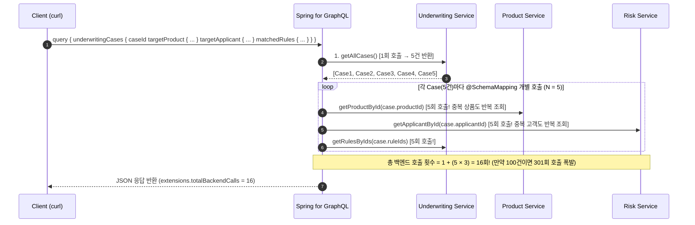
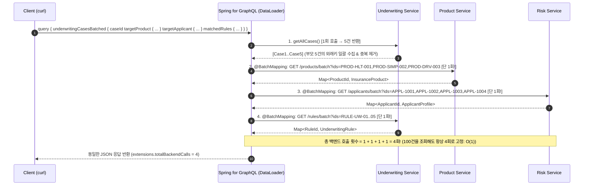
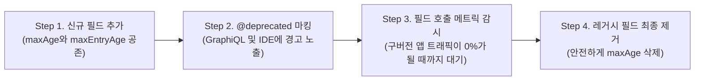
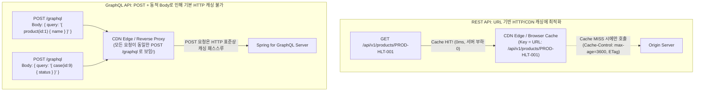
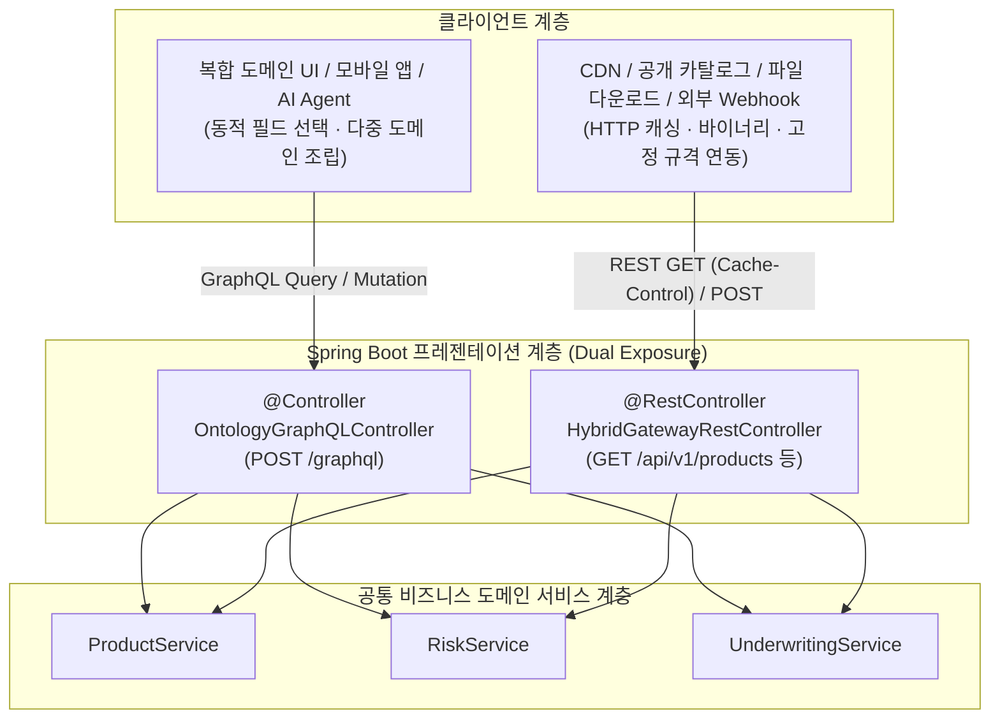

# Chapter 04. GraphQL 실무 주의사항 및 아키텍처 트레이드오프

> **학습 목표**
> 1. GraphQL 서버에서 가장 흔하게 발생하는 성능 병목인 **N+1 문제**의 원인을 이해하고, **DataLoader / `@BatchMapping`**으로 해결하는 과정을 코드와 `curl`로 실증한다.
> 2. 버전 없는 API(Versionless API)를 안전하게 운영하기 위한 **`@deprecated` 전략**과 **오픈소스 스키마 버전 관리 도구(GraphQL Inspector, GraphQL Hive, WunderGraph Cosmo)**를 익힌다.
> 3. **HTTP/CDN 캐싱, 파일 처리 등에서 왜 REST API가 여전히 유효하며**, 실무에서 **REST + GraphQL 하이브리드 아키텍처**를 어떻게 구성해야 하는지 명확한 기준을 수립한다.

---

## 1. N+1 문제(N+1 Query Problem)와 Batch Processing

### 1.1 왜 GraphQL에서는 N+1 문제가 필연적으로 발생하는가?

JPA/Hibernate에서도 지연 로딩(Lazy Loading)으로 인한 N+1 문제가 유명하지만, GraphQL에서는 **설계 구조상 N+1 문제가 훨씬 더 쉽게, 자주 발생**합니다.

그 이유는 **GraphQL의 각 필드 리졸버(`@SchemaMapping`)는 상위 필드가 단건 조회인지 목록(List) 조회인지 알지 못한 채, 각각의 부모 객체마다 독립적으로 호출되기 때문**입니다.

예를 들어 심사건 목록 `underwritingCases`가 **5건**을 반환하고, 각 심사건마다 하위 필드 3개(`targetProduct`, `targetApplicant`, `matchedRules`)를 요청했다고 가정해 봅시다.



### 1.2 해결책: DataLoader 패턴과 Spring for GraphQL의 `@BatchMapping`

이 문제를 해결하기 위해 Meta(Facebook)가 GraphQL과 함께 고안한 표준 패턴이 바로 **DataLoader**입니다.  
DataLoader는 두 가지 핵심 기법으로 동작합니다:

1. **Batching (일괄 수집 후 단 1회 호출)**:
   - 그래프의 같은 깊이(Level)에 있는 5개의 `UnderwritingCase`에 대해 `targetProduct`를 즉시 개별 호출하지 않고, **현재 실행 틱(Tick) 동안 필요한 모든 `productId`를 큐에 모읍니다.**
   - 5건의 부모 객체 순회가 끝나는 순간, 모아둔 ID 목록(`["PROD-HLT-001", "PROD-SIMP-002", "PROD-DRV-003"]`)으로 배치 조회 메서드(`getProductsByIds`)를 **단 1회**만 호출합니다.
2. **Deduplication & Per-Request Caching (요청 내 중복 키 제거 및 캐싱)**:
   - 5건의 심사건 중 3건이 동일한 상품(`PROD-HLT-001`)을 가리키고 있다면, 중복을 제거하여 실제로는 고유한 3개의 ID만 백엔드에 요청합니다.



---

### 1.3 Spring for GraphQL 코드 비교: `@SchemaMapping` (N+1) vs `@BatchMapping` (해결)

본 워크스페이스의 [`OntologyGraphQLController.java`](../backend/src/main/java/com/insure/ontology/graphql/OntologyGraphQLController.java)에 구현된 실제 비교 코드를 살펴봅시다.

#### ❌ N+1이 발생하는 `@SchemaMapping` 구현
```java
// 부모 객체(UnderwritingCase) 1건당 매번 실행됨 -> 목록이 N건이면 N번 호출!
@SchemaMapping(typeName = "UnderwritingCase", field = "targetProduct")
public InsuranceProduct resolveTargetProduct(UnderwritingCase uwCase) {
    return productProvider.getProductById(
            uwCase.targetProductId(),
            "UnderwritingCase(" + uwCase.caseId() + ").targetProduct"
    );
}
```

#### ✅ N+1을 완벽히 해결하는 `@BatchMapping` 구현
Spring for GraphQL에서는 복잡한 `BatchLoaderRegistry` 설정 없이도, 컨트롤러 메서드에 **`@BatchMapping`** 어노테이션만 붙이고 **`List<Parent>`를 인자로 받아 `Map<Parent, Child>`를 반환**하면 내부적으로 DataLoader가 자동 등록·실행됩니다!

```java
// 부모 객체 리스트(List<BatchedUnderwritingCase>) 전체를 한 번에 받아 Map으로 매핑 반환 -> 단 1번만 호출!
@BatchMapping(typeName = "BatchedUnderwritingCase", field = "targetProduct")
public Map<BatchedUnderwritingCase, InsuranceProduct> batchTargetProducts(
        List<BatchedUnderwritingCase> cases
) {
    if (cases.isEmpty()) {
        return Map.of();
    }
    // 1. 모든 심사건에서 조회할 productId 추출
    List<String> productIds = cases.stream()
            .map(BatchedUnderwritingCase::targetProductId)
            .toList();

    // 2. 백엔드 배치 API 또는 DB WHERE product_id IN (...) 쿼리 단 1회 실행
    Map<String, InsuranceProduct> productsById = productProvider.getProductsByIds(
            productIds,
            "BatchedUnderwritingCase[*].targetProduct"
    );

    // 3. 각 부모 객체(Key)에 대응하는 자식 객체(Value)를 Map으로 조립하여 반환
    Map<BatchedUnderwritingCase, InsuranceProduct> result = new LinkedHashMap<>();
    for (BatchedUnderwritingCase uwCase : cases) {
        InsuranceProduct product = productsById.get(uwCase.targetProductId());
        if (product != null) {
            result.put(uwCase, product);
        }
    }
    return result;
}
```

### 1.4 `curl`을 이용한 N+1(16회 호출) vs Batch(4회 호출) 직접 비교

#### ① N+1 발생 쿼리 호출 (`underwritingCases`)
```bash
curl -X POST http://localhost:8080/graphql \
  -H "Content-Type: application/json" \
  -d '{
    "query": "query NPlusOneDemo { underwritingCases { caseId targetProduct { productId productName } targetApplicant { applicantId applicantName } matchedRules { ruleId ruleCode } } }"
  }'
```
응답 하단의 `extensions.totalBackendCalls`를 확인하면 **16회**가 기록됩니다:
```json
{
  "data": { "underwritingCases": [ /* 5건 데이터 */ ] },
  "extensions": {
    "totalBackendCalls": 16,
    "ontologyLineage": [
      { "stepOrder": 1, "endpointUri": "/mock/uw-service/cases" },
      { "stepOrder": 2, "endpointUri": "/mock/product-service/products/PROD-HLT-001" },
      { "stepOrder": 3, "endpointUri": "/mock/product-service/products/PROD-HLT-001" }
      /* ... 총 16개 백엔드 호출 로그 ... */
    ]
  }
}
```

#### ② `@BatchMapping` 최적화 쿼리 호출 (`underwritingCasesBatched`)
```bash
curl -X POST http://localhost:8080/graphql \
  -H "Content-Type: application/json" \
  -d '{
    "query": "query BatchDemo { underwritingCasesBatched { caseId targetProduct { productId productName } targetApplicant { applicantId applicantName } matchedRules { ruleId ruleCode } } }"
  }'
```
응답 데이터(`data`)는 100% 동일하지만, `extensions.totalBackendCalls`는 **4회**로 줄어듭니다:
```json
{
  "data": { "underwritingCasesBatched": [ /* 동일한 5건 데이터 */ ] },
  "extensions": {
    "totalBackendCalls": 4,
    "ontologyLineage": [
      { "stepOrder": 1, "endpointUri": "/mock/uw-service/cases" },
      { "stepOrder": 2, "endpointUri": "/mock/product-service/products/batch?ids=PROD-HLT-001,PROD-SIMP-002,PROD-DRV-003" },
      { "stepOrder": 3, "endpointUri": "/mock/risk-service/applicants/batch?ids=APPL-1001,APPL-1002,APPL-1003,APPL-1004" },
      { "stepOrder": 4, "endpointUri": "/mock/uw-service/rules/batch?ids=RULE-UW-01,RULE-UW-02,RULE-UW-03,RULE-UW-04,RULE-UW-05" }
    ]
  }
}
```

---

## 2. 스키마 진화(Deprecation)와 오픈소스 버전 관리 도구들

### 2.1 왜 GraphQL은 `/v1/graphql`, `/v2/graphql`처럼 URL 버전을 나누지 않는가?

REST API에서는 응답 DTO의 필드 구조를 바꾸거나 이름을 변경하면 기존 모바일 앱(구버전)이 깨지기 때문에 `/api/v1/...`, `/api/v2/...`처럼 엔드포인트 버전을 분리합니다.

반면 GraphQL은 **클라이언트가 자신이 필요한 필드를 명시적으로 요청**하기 때문에, 기존 필드를 유지한 채 새로운 필드를 추가해도 구버전 클라이언트에 아무런 영향을 주지 않습니다. 이를 **Continuous Evolution (지속적 스키마 진화)**이라고 합니다.

### 2.2 Breaking Change vs Non-Breaking Change

스키마를 수정할 때 어떤 변경이 안전하고 어떤 변경이 장애를 유발하는지 명확히 알아야 합니다.

| 구분 | 변경 내용 예시 | 구버전 클라이언트 영향 |
| :--- | :--- | :--- |
| **안전한 변경 (Non-Breaking)** | - 새로운 `type`, `Query`, `Mutation` 추가<br>- 기존 `type`에 새로운 필드 추가<br>- 기존 필드나 `input`에 **Optional(Nullable) 인자** 추가<br>- 기존 필드에 `@deprecated` 태그 부착 | **안전함** (기존 쿼리는 새 필드를 요청하지 않으므로 정상 동작) |
| **위험한 변경 (Breaking Change)** | - 기존 필드 삭제 또는 이름 변경<br>- 출력 필드의 타입 변경 (`Int!` → `String!`) 또는 Non-Null 해제 (`String!` → `String`)<br>- `input`이나 필드 인자에 **필수(`!`) 인자** 새로 추가<br>- `enum`에 클라이언트가 모르는 새로운 값 추가 (클라이언트 switch문 주의) | **장애 발생!** (구버전 모바일 앱이나 웹이 즉시 에러 발생) |

### 2.3 무중단 필드 교체(Deprecation) 4단계 라이프사이클

예를 들어 `InsuranceProduct`의 `maxAge` 필드를 `maxEntryAge`로 이름을 바꾸고 싶다면 절대 바로 지우지 말고 다음 4단계를 거칩니다:



```graphql
type InsuranceProduct {
  productId: ID!
  "신규 필드: 최대 가입 가능 연령(세)"
  maxEntryAge: Int!

  "구버전 호환용 필드"
  maxAge: Int! @deprecated(reason: "명확한 의미 전달을 위해 'maxEntryAge'로 대체되었습니다. 2027-01-01 제거 예정.")
}
```

### 2.4 실무 필수 오픈소스 스키마 버전 관리 및 거버넌스 도구들

사람의 눈으로 PR(Pull Request)을 리뷰하다 보면 실수로 Breaking Change가 운영에 배포될 수 있습니다. 이를 자동화해주는 대표적인 **오픈소스 도구 3대장**은 다음과 같습니다.

| 도구명 | 오픈소스 여부 / 라이선스 | 핵심 역할 및 특징 |
| :--- | :--- | :--- |
| **1. GraphQL Inspector** ([the-guild.dev](https://the-guild.dev/graphql/inspector)) | 완전 오픈소스 (MIT) | - **CI/CD 및 GitHub Actions 연동의 표준 도구**.<br>- `main` 브랜치의 `schema.graphql`과 현재 PR의 `schema.graphql`을 비교(Diff)하여 **Breaking Change, Dangerous Change, Safe Change를 자동 분류**하고 Breaking Change 발견 시 빌드를 실패시킴.<br>- 프론트엔드 코드의 쿼리 조각들과 서버 스키마의 정합성 검증 지원. |
| **2. GraphQL Hive** ([the-guild.dev/graphql/hive](https://the-guild.dev/graphql/hive)) | 오픈소스 (MIT, Self-hosted 가능) | - **오픈소스 GraphQL Schema Registry & Observability 플랫폼**.<br>- 스키마의 모든 변경 히스토리(버전 관리)를 저장.<br>- 게이트웨이/Spring 서버에서 **어떤 필드가 실제로 몇 번 호출되었는지(Field Usage Metrics)** 수집.<br>- 특정 `@deprecated` 필드가 지난 30일간 호출량 `0%`이면 "이제 삭제해도 안전한 Breaking Change입니다"라고 판단해주는 **Conditional Breaking Change** 기능 제공. |
| **3. WunderGraph Cosmo / Apollo Rover** | Cosmo: 오픈소스 (Apache 2.0)<br>Rover CLI: 오픈소스 (MIT) | - 마이크로서비스 환경에서 여러 Subgraph 스키마들을 하나의 Federated Supergraph로 합칠 때 **Composition 충돌 검증** 및 **Schema Check** 수행. |

#### GraphQL Inspector CLI 실행 예시 (CI 파이프라인)
```bash
# 이전 커밋(main) 스키마와 현재 스키마를 비교해 Breaking Change가 있으면 exit code 1 반환
npx @graphql-inspector/cli diff git:origin/main:backend/src/main/resources/schema.graphql backend/src/main/resources/schema.graphql
```

---

## 3. 캐싱 등이 필요한 경우 REST API가 여전히 유효한 이유 (Hybrid Architecture)

세미나에서 **"그러면 이제 REST API는 완전히 버리고 모든 API를 100% GraphQL로 바꿔야 하나요?"**라는 질문을 받으면, 정답은 단호하게 **"아니오(No)"**입니다.

실제로 Netflix, GitHub, Shopify, 그리고 본 레퍼런스 프로젝트([`HybridGatewayRestController.java`](../backend/src/main/java/com/insure/ontology/rest/HybridGatewayRestController.java)) 모두 **GraphQL과 REST를 적재적소에 함께 사용하는 하이브리드 아키텍처**를 채택하고 있습니다.

### 3.1 GraphQL이 HTTP 캐싱에서 불리한 근본적 이유



1. **모든 요청이 `POST /graphql`이다**:
   - HTTP 표준(RFC 9110/9111)과 CloudFront, Cloudflare, Nginx 같은 모든 웹 캐시 인프라는 **`GET` 요청의 URL**을 캐시 키(Cache Key)로 삼습니다.
   - GraphQL은 본문(Body)에 쿼리를 담아 `POST /graphql`로 보내므로 CDN이나 브라우저가 URL만 보고는 상품 목록 조회인지 고객 개인정보 조회인지 구분할 수 없어 HTTP 캐싱이 작동하지 않습니다.
2. **클라이언트마다 쿼리 모양이 다르다**:
   - 설령 쿼리를 URL 파라미터로 옮기더라도, 클라이언트 A는 `{ id name }`을 요청하고 클라이언트 B는 `{ name id price }`를 요청하면 문자열이 달라 캐시 적중률(Cache Hit Ratio)이 떨어집니다.

> **참고 — Automatic Persisted Queries (APQ)**:  
> Apollo 등에서는 쿼리 전문 대신 쿼리의 SHA-256 해시값만 `GET /graphql?extensions={"persistedQuery":{"sha256Hash":"..."}}`로 보내어 CDN 캐싱을 가능하게 하는 **APQ** 기법을 제공합니다. 하지만 이 역시 설정 복잡도가 높고, 응답 내에 유저별 개인화 필드와 공용 필드가 섞여 있으면 전체 응답 캐싱이 불가능합니다.

### 3.2 REST API가 GraphQL보다 훨씬 유리한 5가지 영역

| 시나리오 | 왜 REST API가 더 적합한가? |
| :--- | :--- |
| **1. CDN/HTTP 캐싱이 필수적인 공개 데이터** | 비로그인 메인 페이지 배너, 공용 상품 카탈로그(`GET /api/v1/products`), 약관 PDF 메타데이터 등 수만 명이 똑같이 조회하는 데이터는 REST `GET` + `Cache-Control` / `ETag`가 압도적으로 빠르고 저렴함. |
| **2. 파일 업로드 및 대용량 바이너리/스트리밍** | 이미지/엑셀/PDF 업로드(`multipart/form-data`), 청약서 PDF 다운로드, 동영상 스트리밍(`Range` 헤더), SSE/청크 스트리밍은 JSON 파싱 기반인 GraphQL을 거치면 불필요한 메모리 오버헤드가 발생함. |
| **3. 외부 파트너사 연동 (B2B Webhook / Open API)** | 타 금융사, PG사, 알림톡 벤더와 연동할 때 상대방 시스템은 표준 REST Webhook(`POST /webhooks/payment`)과 명확한 HTTP 상태 코드(`200`, `400`, `401`, `500`)를 기대함. |
| **4. 고정된 단일 목적의 초고성능 트랜잭션 API** | 예: 단순 헬스체크(`GET /actuator/health`), 인증 토큰 발급(`POST /oauth/token`), 초당 수만 건 발생하는 고정 포맷 이벤트 수집 API. |
| **5. HTTP 상태 코드 기반의 단순 인프라 라우팅/WAF 제어** | 특정 URL 경로(`/api/admin/**`)에만 IP 화이트리스트나 WAF(웹 방화벽) Rate Limit을 걸어야 하는 경우. |

### 3.3 실무 권장 아키텍처: GraphQL + REST 하이브리드 전략

가장 이상적인 현대 백엔드 아키텍처는 **도메인 서비스 레이어(`@Service`)를 공유**하면서, 위에 **GraphQL Controller**와 **REST Controller**를 목적에 맞게 함께 열어두는 것입니다.



---

## 4. 추가 주의사항: 악의적인 깊은 쿼리(Query Depth & Complexity) 방어

GraphQL은 클라이언트가 원하는 만큼 쿼리를 중첩시킬 수 있기 때문에,もし 양방향 참조(`Product -> Case -> Product -> Case ...`)가 스키마에 존재할 때 악의적인 사용자가 100단계 깊이의 쿼리를 보내면 서버 CPU와 DB가 마비(DoS)될 수 있습니다.

따라서 운영 환경의 Spring for GraphQL 서버에는 반드시 **`MaxQueryDepthInstrumentation`**(최대 중첩 깊이 제한)과 **`MaxQueryComplexityInstrumentation`**(최대 필드 복잡도 점수 제한)을 Bean으로 등록해야 합니다.

### Spring Boot 쿼리 깊이 및 복잡도 제한 설정 예제
```java
package com.insure.ontology.config;

import graphql.analysis.MaxQueryComplexityInstrumentation;
import graphql.analysis.MaxQueryDepthInstrumentation;
import org.springframework.context.annotation.Bean;
import org.springframework.context.annotation.Configuration;

@Configuration
public class GraphQlSecurityInstrumentationConfig {

    // 1. 쿼리의 최대 중첩 깊이(Depth)를 7단계로 제한 (초과 시 실행 전 즉시 거부)
    @Bean
    public MaxQueryDepthInstrumentation maxQueryDepthInstrumentation() {
        return new MaxQueryDepthInstrumentation(7);
    }

    // 2. 단일 쿼리의 최대 필드 복잡도(Complexity) 총합을 150점으로 제한
    @Bean
    public MaxQueryComplexityInstrumentation maxQueryComplexityInstrumentation() {
        return new MaxQueryComplexityInstrumentation(150);
    }
}
```

---

> **다음 챕터 예고**: [Chapter 05. Spring for GraphQL 심화 가이드](./05-spring-for-graphql-deep-dive.md)에서는 Spring Boot 애플리케이션의 `Controller`, `Service`, `Repository`에 GraphQL이 어떻게 자연스럽게 녹아드는지, 주요 어노테이션과 **동적 Join 최적화(`DataFetchingFieldSelectionSet`)**, 그리고 **단위/통합 테스트(`GraphQlTester`)** 작성법을 상세히 다룹니다.
