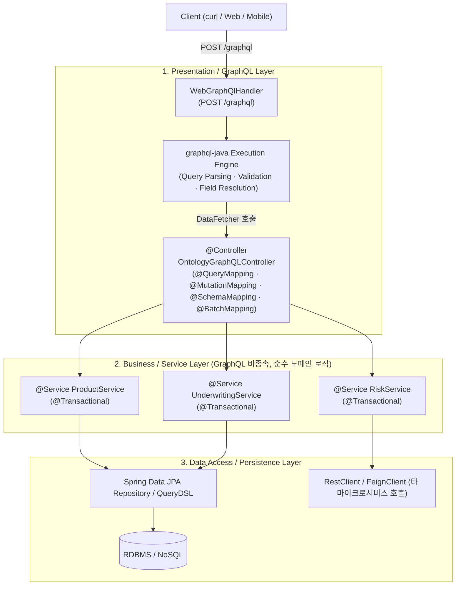
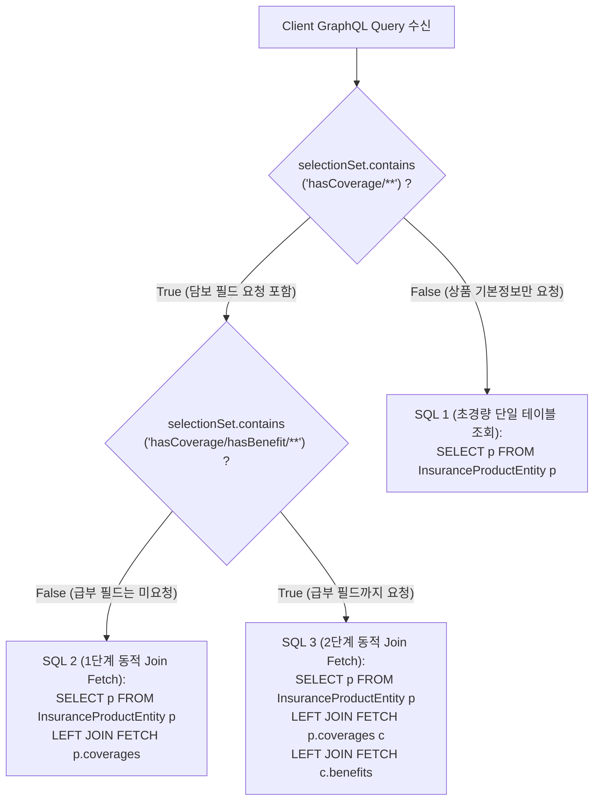
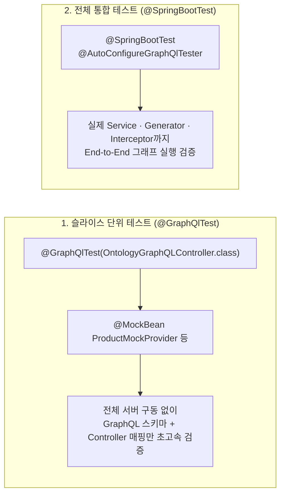

# Chapter 05. Spring for GraphQL 심화 가이드

> **학습 목표**
> 1. **Spring for GraphQL**의 탄생 배경과 아키텍처, 그리고 기존 Spring Boot의 **`Controller` - `Service` - `Repository`** 계층에 GraphQL이 어떻게 자연스럽게 녹아드는지 이해한다.
> 2. 핵심 어노테이션(**`@QueryMapping`**, **`@MutationMapping`**, **`@SchemaMapping`**, **`@BatchMapping`**, **`@Argument`**, **`@GraphQlExceptionHandler`**)의 동작 원리와 사용법을 마스터한다.
> 3. **`DataFetchingFieldSelectionSet`을 활용한 동적 Join 최적화**(클라이언트가 하위 필드를 요청했을 때만 DB `JOIN FETCH`를 수행하는 기법)를 실제 코드로 익힌다.
> 4. **`@GraphQlTest`**와 **`GraphQlTester`**를 이용한 단위 테스트(Unit Test) 및 통합 테스트 작성법을 습득한다.

---

## 1. Spring for GraphQL 소개

### 1.1 Spring for GraphQL이란?

과거 Spring Boot 환경에서 GraphQL을 도입하려면 서드파티 라이브러리(`graphql-java-kickstart`, `spqr` 등)나 Netflix의 `DGS Framework`를 별도로 구성해야 했습니다.  
이를 표준화하기 위해 **Spring 공식 팀**과 **`graphql-java` 창시자 팀**이 공동 개발하여 Spring Boot 2.7 / 3.0부터 공식 스타터(**`spring-boot-starter-graphql`**)로 제공하는 프로젝트가 바로 **Spring for GraphQL**입니다.

### 1.2 핵심 설계 철학: Schema-First & Spring MVC 프로그래밍 모델 계승

1. **Schema-First (스키마 우선주의)**:
   - Java 클래스에 어노테이션을 덕지덕지 붙여서 스키마를 역으로 생성(Code-First)하지 않습니다.
   - 먼저 `src/main/resources/graphql/*.graphqls`에 깔끔한 GraphQL SDL 스키마를 정의하고, Spring `@Controller`가 그 스키마의 타입과 필드에 메서드(`DataFetcher`)를 연결(Wiring)합니다.
2. **익숙한 Spring 어노테이션 모델**:
   - Spring MVC의 `@RequestMapping`, `@GetMapping`, `@PostMapping`, `@RequestParam`에 대응하는 **`@SchemaMapping`, `@QueryMapping`, `@MutationMapping`, `@Argument`**를 제공하여 기존 Spring 개발자가 하루 만에 적응할 수 있습니다.
3. **전송 계층 독립성 (WebMVC & WebFlux 모두 지원)**:
   - `spring-boot-starter-web`(Servlet/Virtual Threads)과 `spring-boot-starter-webflux`(Reactive `Mono`/`Flux`) 양쪽 모두에서 동일한 어노테이션으로 동작합니다.

### 1.3 Maven (`pom.xml`) 의존성 구성

본 프로젝트의 [`backend/pom.xml`](../backend/pom.xml)과 동일하게 단 두 개의 스타터만으로 즉시 구동됩니다.

```xml
<dependencies>
    <!-- Spring MVC 기반 웹 서버 -->
    <dependency>
        <groupId>org.springframework.boot</groupId>
        <artifactId>spring-boot-starter-web</artifactId>
    </dependency>

    <!-- Spring for GraphQL 공식 스타터 -->
    <dependency>
        <groupId>org.springframework.boot</groupId>
        <artifactId>spring-boot-starter-graphql</artifactId>
    </dependency>

    <!-- GraphQL 테스트 전용 도구 (GraphQlTester) -->
    <dependency>
        <groupId>org.springframework.graphql</groupId>
        <artifactId>spring-graphql-test</artifactId>
        <scope>test</scope>
    </dependency>
</dependencies>
```

---

## 2. Controller, Service, Repository에 GraphQL이 어떻게 녹아 들어가는가?

### 2.1 기존 계층형 아키텍처(Layered Architecture)와의 결합 구조

많은 개발자들이 *"GraphQL을 도입하면 기존에 만들어 둔 `@Service`나 JPA `@Repository`까지 다 뜯어고쳐야 하나요?"*라고 걱정합니다.  
**전혀 그렇지 않습니다.** GraphQL은 철저히 **프레젠테이션/게이트웨이 계층(Controller Layer)**의 기술입니다.



### 2.2 각 계층의 명확한 역할 분담

1. **`@Controller` (GraphQL DataFetcher 계층)**:
   - GraphQL 스키마의 `Query`, `Mutation` 루트 필드와 각 `type`의 연관 객체 필드(`@SchemaMapping`, `@BatchMapping`)를 매핑합니다.
   - **주의**: `@Transactional`은 컨트롤러가 아니라 **`@Service` 계층**에 두는 것이 원칙입니다. 왜냐하면 하나의 GraphQL 쿼리 안에서 여러 `@SchemaMapping`이나 `@BatchMapping`이 실행될 수 있는데, 각각이 독립적인 서비스 호출 단위가 되기 때문입니다.
2. **`@Service` (비즈니스 로직 및 트랜잭션 계층)**:
   - REST Controller가 호출하든 GraphQL Controller가 호출하든 동일한 비즈니스 규칙과 트랜잭션을 수행합니다.
   - 단, `@BatchMapping`을 지원하기 위해 단건 조회(`findById(id)`) 외에도 **다건 ID 컬렉션 조회(`findAllByIds(Collection<ID> ids)`)** 메서드를 함께 제공하는 것이 좋습니다.
3. **`@Repository` (데이터 접근 계층)**:
   - `findAllByIdIn(Collection<ID> ids)` 또는 동적 Fetch Join 쿼리를 제공하여 GraphQL의 그래프 탐색을 뒷받침합니다.

---

## 3. Spring for GraphQL 주요 어노테이션 완벽 정리

### 3.1 핵심 매핑 어노테이션 한눈에 보기

| 어노테이션 | 매핑 대상 | 주요 특징 및 사용법 |
| :--- | :--- | :--- |
| **`@SchemaMapping`** | 모든 GraphQL `type`의 특정 `field` | 가장 범용적인 어노테이션. `typeName`과 `field`를 지정하여 부모 객체(Source)로부터 자식 필드를 해석함.<br>예: `@SchemaMapping(typeName = "UnderwritingCase", field = "targetProduct")` |
| **`@QueryMapping`** | `type Query`의 필드 | `@SchemaMapping(typeName = "Query")`의 축약형(Shortcut). 메서드 이름이 스키마의 Query 필드명과 같으면 `name` 속성 생략 가능. |
| **`@MutationMapping`** | `type Mutation`의 필드 | `@SchemaMapping(typeName = "Mutation")`의 축약형. 상태 변경 작업에 사용. |
| **`@SubscriptionMapping`** | `type Subscription`의 필드 | `@SchemaMapping(typeName = "Subscription")`의 축약형. `Flux<T>`를 반환하여 WebSocket/SSE 실시간 스트리밍 처리. |
| **`@BatchMapping`** | 부모 리스트(`List<Parent>`)의 하위 필드 일괄 조회 | **N+1 해결의 핵심**. 내부적으로 `BatchLoaderRegistry`에 DataLoader를 자동 등록하고 `Map<Parent, Child>` 또는 `Mono<Map<Parent, Child>>`를 반환. |
| **`@Argument`** | GraphQL 필드의 특정 인자(`(id: ID!, input: ...)`) | Spring MVC의 `@RequestParam` + `@RequestBody` 역할. Java Record, DTO, 기본 타입으로 자동 역직렬화 및 Bean Validation(`@Valid`) 지원. |
| **`@ContextValue`** | `GraphQLContext`에 저장된 요청 범위 값 | `WebGraphQlInterceptor` 등에서 주입한 커스텀 헤더, 트레이스 ID, 로케일 정보 등을 꺼낼 때 사용. |
| **`@GraphQlExceptionHandler`** | 리졸버 실행 중 발생한 예외 처리 | Spring MVC의 `@ExceptionHandler`와 동일. 비즈니스 예외를 표준 `GraphQLError`(`ErrorType.NOT_FOUND`, `BAD_REQUEST` 등)로 변환. |

### 3.2 `@SchemaMapping`의 동작 규칙: 언제 생략할 수 있고 언제 작성해야 하는가?

Spring for GraphQL은 모든 필드에 일일이 `@SchemaMapping`을 작성할 필요가 없습니다!
- **자동 매핑 (PropertyDataFetcher)**:
  - `UnderwritingCase` Java Record(또는 클래스)에 이미 `caseId()`, `applicationDate()`, `uwStatus()`, `decision()` 메서드가 존재한다면, Spring for GraphQL이 **리플렉션으로 같은 이름의 Getter/Record 컴포넌트를 자동으로 찾아 매핑**합니다.
- **`@SchemaMapping`을 명시적으로 작성하는 경우**:
  - 부모 객체(`UnderwritingCase`)에는 외래키(`targetProductId = "PROD-HLT-001"`)만 들어 있고, 실제 `targetProduct: InsuranceProduct` 객체는 **다른 서비스(`ProductMockProvider`)나 DB 조회를 통해 가져와야 할 때**만 `@SchemaMapping`(또는 `@BatchMapping`) 메서드를 작성합니다.

```java
@Controller
public class OntologyGraphQLController {

    // 1. 루트 Query 매핑: UnderwritingCase 기본 객체 반환
    //    (caseId, applicationDate, uwStatus, decision 필드는 Record 컴포넌트에서 자동 추출됨!)
    @QueryMapping
    public UnderwritingCase underwritingCase(@Argument String caseId) {
        return uwProvider.getCaseById(caseId);
    }

    // 2. 클라이언트가 쿼리에 'targetProduct { ... }'를 포함했을 때만 실행됨!
    //    첫 번째 파라미터(UnderwritingCase uwCase)로 부모 객체가 자동 주입됨
    @SchemaMapping(typeName = "UnderwritingCase", field = "targetProduct")
    public InsuranceProduct resolveTargetProduct(UnderwritingCase uwCase) {
        return productProvider.getProductById(
                uwCase.targetProductId(),
                "UnderwritingCase(" + uwCase.caseId() + ").targetProduct"
        );
    }
}
```

> **중요 포인트 (Lazy Field Execution)**:  
> 클라이언트가 `query { underwritingCase(caseId: "...") { caseId uwStatus } }`처럼 **`targetProduct` 필드를 요청하지 않으면, `resolveTargetProduct()` 메서드는 아예 실행되지 않습니다!** 이것이 REST 오케스트레이션 대비 GraphQL이 백엔드 리소스를 절약하는 핵심 원리입니다.

### 3.3 `@GraphQlExceptionHandler`를 통한 깔끔한 에러 처리 예제

```java
@ControllerAdvice
public class GlobalGraphQlExceptionHandler {

    @GraphQlExceptionHandler(IllegalArgumentException.class)
    public GraphQLError handleBadRequest(IllegalArgumentException ex, DataFetchingEnvironment env) {
        return GraphqlErrorBuilder.newError(env)
                .errorType(ErrorType.BAD_REQUEST)
                .message(ex.getMessage())
                .extensions(Map.of("errorCode", "INVALID_INPUT_PARAMETER"))
                .build();
    }
}
```

---

## 4. 실무 최적화 기법: 특정 Join을 타야 하는 경우 (`DataFetchingFieldSelectionSet`)

세미나에서 백엔드 엔지니어들이 가장 궁금해하는 실전 최적화 포인트입니다.

### 4.1 문제 상황: `@BatchMapping`만으로는 아쉬운 순간이 있다!

앞서 Chapter 04에서 `@BatchMapping`으로 N+1 쿼리(1 + N회)를 **1 + 1 = 2회**(`SELECT * FROM products` 후 `SELECT * FROM coverages WHERE product_id IN (...)`)로 줄이는 방법을 배웠습니다.
- **마이크로서비스 간 호출(MSA)**에서는 물리적으로 DB가 분리되어 있으므로 `@BatchMapping`(2회 호출)이 최선입니다.
- **하지만 하나의 RDBMS 안에 `insurance_product` 테이블과 `coverage` 테이블이 함께 있고 JPA/QueryDSL을 쓰는 경우라면 어떨까요?**
  - 특히 두 테이블을 `JOIN`해서 필터링하거나 정렬해야 하거나, 네트워크 라운드트립을 **2번(1+1)이 아니라 단 1번의 `LEFT JOIN FETCH` 쿼리**로 끝내고 싶을 때가 있습니다.
  - 그렇다고 `@QueryMapping`에서 **무조건 `JOIN FETCH`를 걸어버리면**, 클라이언트가 단순히 상품명(`{ productId productName }`)만 요청했을 때도 무거운 `coverage`, `benefit_condition` 테이블까지 불필요하게 3중 Join을 타는 성능 낭비가 발생합니다!

### 4.2 해결책: `DataFetchingFieldSelectionSet`으로 클라이언트가 요청한 필드 미리 엿보기 (Lookahead)

Spring for GraphQL은 `@QueryMapping` 컨트롤러 메서드에 **`DataFetchingFieldSelectionSet`** 파라미터를 주입해 줍니다.  
이를 통해 **루트 쿼리가 실행되는 시점에 클라이언트가 하위 필드(`hasCoverage`, `hasCoverage/hasBenefit`)를 요청했는지 여부를 미리 확인(Lookahead)**하고, 필요한 테이블만 동적으로 `JOIN FETCH`하도록 Service/Repository에 지시할 수 있습니다!



### 4.3 실전 Java 구현 코드: `DataFetchingFieldSelectionSet` + 동적 Join 최적화

#### Step 1: GraphQL Controller에서 `DataFetchingFieldSelectionSet` 주입받기
```java
package com.insure.ontology.graphql;

import graphql.schema.DataFetchingFieldSelectionSet;
import org.springframework.graphql.data.method.annotation.Argument;
import org.springframework.graphql.data.method.annotation.QueryMapping;
import org.springframework.stereotype.Controller;
import java.util.List;

@Controller
public class OptimizedProductGraphQLController {

    private final ProductOptimizationService productService;

    public OptimizedProductGraphQLController(ProductOptimizationService productService) {
        this.productService = productService;
    }

    @QueryMapping
    public List<InsuranceProduct> insuranceProducts(
            @Argument String category,
            DataFetchingFieldSelectionSet selectionSet // Spring for GraphQL이 자동 주입!
    ) {
        // 클라이언트가 쿼리에 하위 연관 필드를 포함했는지 Glob 패턴으로 검사
        boolean fetchCoverages = selectionSet.contains("hasCoverage/**");
        boolean fetchBenefits = selectionSet.contains("hasCoverage/hasBenefit/**");

        FetchPlan plan = new FetchPlan(fetchCoverages, fetchBenefits);
        return productService.findProductsOptimized(category, plan);
    }

    public record FetchPlan(boolean fetchCoverages, boolean fetchBenefits) {}
}
```

#### Step 2: Service & Repository(JPA / QueryDSL / EntityGraph)에서 조건부 Join 실행
```java
package com.insure.ontology.service;

import com.insure.ontology.graphql.OptimizedProductGraphQLController.FetchPlan;
import jakarta.persistence.EntityManager;
import jakarta.persistence.TypedQuery;
import org.springframework.stereotype.Service;
import org.springframework.transaction.annotation.Transactional;
import java.util.List;

@Service
@Transactional(readOnly = true)
public class ProductOptimizationService {

    private final EntityManager em;

    public ProductOptimizationService(EntityManager em) {
        this.em = em;
    }

    public List<InsuranceProduct> findProductsOptimized(String category, FetchPlan plan) {
        StringBuilder jpql = new StringBuilder("SELECT DISTINCT p FROM InsuranceProductEntity p ");

        // 클라이언트가 hasCoverage 필드를 요청했을 때만 LEFT JOIN FETCH 추가!
        if (plan.fetchCoverages()) {
            jpql.append("LEFT JOIN FETCH p.hasCoverage c ");
        }
        // 클라이언트가 hasCoverage.hasBenefit 필드까지 요청했을 때만 2단계 JOIN FETCH 추가!
        if (plan.fetchBenefits()) {
            jpql.append("LEFT JOIN FETCH c.hasBenefit b ");
        }
        if (category != null && !category.isBlank()) {
            jpql.append("WHERE p.productCategory = :category");
        }

        TypedQuery<InsuranceProductEntity> query = em.createQuery(jpql.toString(), InsuranceProductEntity.class);
        if (category != null && !category.isBlank()) {
            query.setParameter("category", category);
        }

        return query.getResultList().stream()
                .map(InsuranceProductEntity::toDomainModel)
                .toList();
    }
}
```

#### Step 3: 만약 `@SchemaMapping`이나 `@BatchMapping`이 함께 선언되어 있다면? (중복 호출 방지 패턴)
부모 쿼리에서 이미 `JOIN FETCH`로 자식 리스트(`hasCoverage`)를 채워왔더라도, 혹시 다른 경로(예: `UnderwritingCase -> targetProduct -> hasCoverage`)로 진입했을 때를 대비해 `@SchemaMapping`이 존재할 수 있습니다. 이때는 **부모 객체에 이미 데이터가 로드되어 있는지 확인 후 없을 때만 조회**하도록 작성하면 완벽합니다.

```java
@SchemaMapping(typeName = "InsuranceProduct", field = "hasCoverage")
public List<Coverage> resolveCoverages(InsuranceProduct product) {
    // 1. 루트 쿼리에서 동적 JOIN FETCH로 이미 채워져 왔다면 DB 호출 없이 즉시 반환!
    if (product.hasCoverage() != null && !product.hasCoverage().isEmpty()) {
        return product.hasCoverage();
    }
    // 2. 채워져 있지 않은 경우에만 Repository 조회 수행
    return productProvider.getCoveragesByProductId(product.productId());
}
```

### 4.4 최적화 전략 선택 가이드: 언제 `JOIN FETCH`를 쓰고 언제 `@BatchMapping`을 쓸까?

| 상황 | 권장 최적화 기법 | 이유 |
| :--- | :--- | :--- |
| **타 마이크로서비스(REST/gRPC) 호출** 또는 **이종 DB(RDB + MongoDB) 조립** | **`@BatchMapping` (DataLoader)** | 물리적으로 SQL `JOIN`이 불가능하므로 ID 목록을 모아 Batch API로 1회 호출하는 것이 최선. |
| **동일 RDBMS 내 1:1 또는 N:1 연관관계** 및 **단일 1:N 컬렉션** | **`DataFetchingFieldSelectionSet` + 동적 `JOIN FETCH`** | DB 왕복을 2회(1+1)에서 **단 1회**로 줄이고 인덱스 조인을 그대로 활용 가능. |
| **동일 RDBMS 내 2개 이상의 서로 다른 1:N 컬렉션 동시 조회** (예: `matchedRules`와 `attachments`) | **`@BatchMapping` 또는 Hibernate `@BatchSize`** | RDBMS에서 2개 이상의 1:N 컬렉션을 동시에 `JOIN FETCH`하면 카테시안 곱(Cartesian Product / `MultipleBagFetchException`)으로 행이 뻥튀기되므로, 각각 `@BatchMapping`(`WHERE id IN (...)`)으로 분리 조회하는 것이 훨씬 빠르고 안전함! |

---

## 5. Spring for GraphQL 단위 테스트(Unit Test) 및 통합 테스트 작성법

Spring for GraphQL은 `spring-graphql-test` 모듈을 통해 **`GraphQlTester`**라는 전용 테스트 클라이언트를 제공합니다.  
`MockMvc`로 복잡한 JSON 문자열을 직접 파싱할 필요 없이, 체이닝(Fluent API) 방식으로 쿼리 실행, 변수 주입, 경로별(`path(...)`) 타입 변환 및 검증을 우아하게 수행할 수 있습니다.

### 5.1 테스트의 두 가지 레벨



---

### 5.2 예제 ①: `@GraphQlTest`를 이용한 Controller 슬라이스 단위 테스트 (Unit Test)

`@WebMvcTest`가 웹 컨트롤러만 띄우듯, **`@GraphQlTest`**는 GraphQL 스키마 파서와 지정한 `@Controller` 빈만 메모리에 올립니다. 하위 `@Service`는 `@MockBean`(또는 Spring Boot 3.4+의 `@MockitoBean`)으로 모킹하여 컨트롤러의 어노테이션 매핑(`@QueryMapping`, `@MutationMapping`, `@SchemaMapping`, `@BatchMapping`)과 인자 바인딩이 정확한지 검증합니다.

```java
package com.insure.ontology.graphql;

import com.insure.ontology.lineage.LineageTraceCollector;
import com.insure.ontology.model.DomainModels.*;
import com.insure.ontology.provider.ProductMockProvider;
import com.insure.ontology.provider.RiskMockProvider;
import com.insure.ontology.provider.UnderwritingMockProvider;
import org.junit.jupiter.api.DisplayName;
import org.junit.jupiter.api.Test;
import org.springframework.beans.factory.annotation.Autowired;
import org.springframework.boot.test.autoconfigure.graphql.GraphQlTest;
import org.springframework.boot.test.mock.mockito.MockBean;
import org.springframework.graphql.test.tester.GraphQlTester;

import java.util.List;

import static org.assertj.core.api.Assertions.assertThat;
import static org.mockito.ArgumentMatchers.any;
import static org.mockito.ArgumentMatchers.eq;
import static org.mockito.BDDMockito.given;
import static org.mockito.Mockito.verify;

@GraphQlTest(OntologyGraphQLController.class)
class OntologyGraphQLControllerUnitTest {

    @Autowired
    private GraphQlTester graphQlTester;

    @MockBean
    private ProductMockProvider productProvider;

    @MockBean
    private RiskMockProvider riskProvider;

    @MockBean
    private UnderwritingMockProvider uwProvider;

    @MockBean
    private LineageTraceCollector lineageCollector;

    @Test
    @DisplayName("@QueryMapping 및 @SchemaMapping이 부모-자식 객체를 정확히 조립하는지 단위 테스트")
    void shouldResolveUnderwritingCaseAndTargetProduct() {
        // Given: Mock 데이터 준비
        UnderwritingDecision decision = new UnderwritingDecision(
                "DEC-001", "STANDARD_ACCEPT", 0.0, 89000, List.of(), "표준 승낙"
        );
        UnderwritingCase mockCase = new UnderwritingCase(
                "UW-CASE-TEST-01", "2026-11-15", "GA_DESIGNER", "COMPLETED",
                "PROD-HLT-001", "APPL-1001", List.of(), decision
        );
        InsuranceProduct mockProduct = new InsuranceProduct(
                "PROD-HLT-001", "테스트 종합건강보험", "HEALTH", "STANDARD", 89000, 65, List.of()
        );

        given(uwProvider.getCaseById("UW-CASE-TEST-01")).willReturn(mockCase);
        given(productProvider.getProductById(eq("PROD-HLT-001"), any())).willReturn(mockProduct);

        // When & Then: GraphQlTester로 쿼리 실행 및 경로별 응답 검증
        String document = """
                query GetCase($id: ID!) {
                  underwritingCase(caseId: $id) {
                    caseId
                    uwStatus
                    targetProduct {
                      productId
                      productName
                      baseMonthlyPremium
                    }
                    decision {
                      decisionOutcome
                      finalMonthlyPremium
                    }
                  }
                }
                """;

        graphQlTester.document(document)
                .variable("id", "UW-CASE-TEST-01")
                .execute()
                .errors().verify() // 에러가 0건인지 검증
                .path("underwritingCase.caseId").entity(String.class).isEqualTo("UW-CASE-TEST-01")
                .path("underwritingCase.targetProduct.productName").entity(String.class).isEqualTo("테스트 종합건강보험")
                .path("underwritingCase.targetProduct.baseMonthlyPremium").entity(Integer.class).isEqualTo(89000)
                .path("underwritingCase.decision.decisionOutcome").entity(String.class).isEqualTo("STANDARD_ACCEPT");

        // @SchemaMapping이 정확한 외래키(PROD-HLT-001)로 호출되었는지 검증
        verify(productProvider).getProductById(eq("PROD-HLT-001"), any());
    }
}
```

---

### 5.3 예제 ②: `@SpringBootTest` + `@AutoConfigureGraphQlTester` 통합 테스트

실제 본 프로젝트의 [`OntologyToGraphQLIntegrationTest.java`](../backend/src/test/java/com/insure/ontology/OntologyToGraphQLIntegrationTest.java)에 작성되어 있는 통합 테스트 코드입니다.  
3개 도메인(`Product`, `Risk`, `Underwriting`)을 관통하는 깊은 그래프 쿼리와 N+1 vs `@BatchMapping` 백엔드 호출 횟수(`16회` vs `4회`)를 자동 검증합니다.

```java
@SpringBootTest
@AutoConfigureGraphQlTester
class OntologyToGraphQLIntegrationTest {

    @Autowired
    private GraphQlTester graphQlTester;

    @Test
    void shouldExecuteCrossDomainGraphQLQuery() {
        String query = """
                query GetCaseGraph {
                  underwritingCase(caseId: "UW-CASE-2026-002") {
                    caseId
                    uwStatus
                    targetProduct {
                      productId
                      productName
                      underwritingTrack
                      hasCoverage {
                        coverageCode
                        coverageName
                        sensitiveRiskCategory
                      }
                    }
                    targetApplicant {
                      applicantName
                      age
                      riskAssessment {
                        totalRiskScore
                        riskGrade
                      }
                    }
                    decision {
                      decisionOutcome
                      finalMonthlyPremium
                    }
                  }
                }
                """;

        graphQlTester.document(query)
                .execute()
                .path("underwritingCase.caseId").entity(String.class).isEqualTo("UW-CASE-2026-002")
                .path("underwritingCase.targetProduct.productName").entity(String.class).isEqualTo("무배당 시그니처 100세 종합건강보험")
                .path("underwritingCase.targetApplicant.applicantName").entity(String.class).isEqualTo("박서연")
                .path("underwritingCase.targetApplicant.riskAssessment.totalRiskScore").entity(Integer.class).isEqualTo(68)
                .path("underwritingCase.decision.decisionOutcome").entity(String.class).isEqualTo("SUBSTANDARD_LOADING")
                .path("underwritingCase.decision.finalMonthlyPremium").entity(Integer.class).isEqualTo(126380);
    }
}
```

### 5.4 `GraphQlTester`의 유용한 검증 메서드 요약

- `.variable("input", Map.of(...))`: 쿼리 변수(`$input`) 주입
- `.errors().verify()`: 응답에 `errors`가 없음을 단언
- `.errors().expect(err -> err.getErrorType() == ErrorType.FORBIDDEN)`: 특정 에러가 발생했음을 검증 (Security 테스트에 필수!)
- `.path("insuranceProducts").entityList(InsuranceProduct.class).hasSize(3)`: 리스트 응답 역직렬화 및 개수 검증
- `.path("underwritingCase.targetApplicant").valueIsNull()`: 특정 필드가 `null`인지 검증

---

> **다음 챕터 예고**: 이제 Spring for GraphQL로 서버를 구축하는 법을 알았으니, 엔터프라이즈 환경에서 가장 중요한 **보안(Security)**을 다룰 차례입니다. [Chapter 06. Spring for GraphQL Security (인증과 인가)](./06-spring-graphql-security.md)에서는 단일 엔드포인트(`POST /graphql`) 환경에서 **Spring Security**를 어떻게 연결하고, 케이스별 **Authentication(인증)**과 **Authorization(인가: RBAC, 필드 단위 마스킹, 객체 소유권 검증)**을 어떻게 구현하는지 상세한 예제 코드로 알아봅니다.
