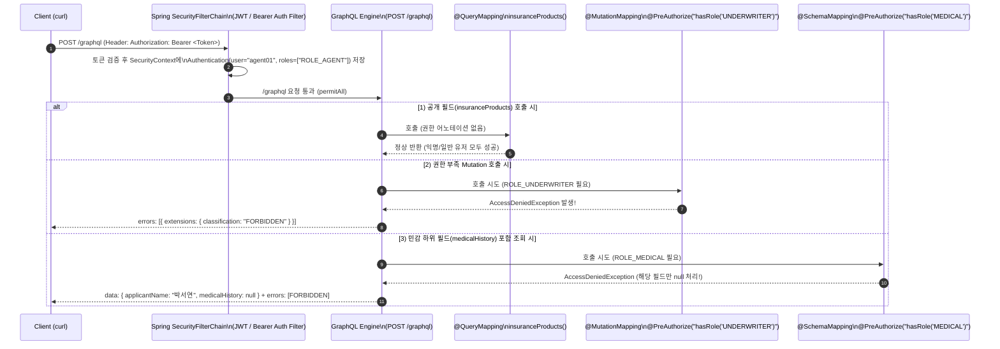

# Chapter 06. Spring for GraphQL Security (인증과 인가 완벽 가이드)

> **학습 목표**
> 1. 왜 GraphQL에서는 REST API처럼 URL 경로 기반(`requestMatchers("/admin/**")`) 인가를 사용할 수 없는지 아키텍처 수준에서 이해한다.
> 2. **Spring Security (`SecurityFilterChain` + `@EnableMethodSecurity`)**를 Spring for GraphQL과 연결하는 표준 설정 방법을 마스터한다.
> 3. 실무에서 마주치는 **5가지 핵심 Authentication(인증) & Authorization(인가) 케이스**(공개/비공개 분리, RBAC, **필드 레벨 부분 인가**, 객체 소유권 ABAC, 스키마 `@directive` 인가)를 `curl`과 Java 코드로 상세히 학습한다.

---

## 1. 왜 GraphQL의 보안 아키텍처는 REST와 다른가?

### 1.1 REST의 URL 기반 보안 vs GraphQL의 리졸버(메서드/필드) 기반 보안

REST API에서는 리소스와 행위가 URL 및 HTTP 메서드로 구분되므로, Spring Security의 `SecurityFilterChain`에서 URL 패턴 매칭만으로 상당 부분의 인가(Authorization)를 처리할 수 있었습니다:
- `GET /api/v1/products/**` → `permitAll()` (누구나 조회 가능)
- `GET /api/v1/cases/**` → `hasAnyRole("AGENT", "UNDERWRITER")`
- `POST /api/v1/admin/**` → `hasRole("ADMIN")`

**그러나 GraphQL에서는 모든 요청이 오직 `POST /graphql` 단일 엔드포인트로 들어옵니다!**
-もし `SecurityFilterChain`에서 `requestMatchers("/graphql").authenticated()`로 막아버리면, 비로그인 사용자는 공개 상품 카탈로그(`insuranceProducts`)조차 조회할 수 없게 됩니다.
- 반대로 `requestMatchers("/graphql").permitAll()`만 설정하고 끝내면, 누구나 관리자 전용 Mutation을 호출할 수 있는 보안 사고가 발생합니다.

### 1.2 Spring for GraphQL의 표준 2단계 보안 아키텍처

따라서 Spring for GraphQL 공식 문서는 다음과 같은 **2단계 보안 구조**를 표준으로 권장합니다:

1. **HTTP Filter 계층 (`SecurityFilterChain`) — Authentication (인증 토큰 파싱)**:
   - `/graphql` 엔드포인트 자체는 `permitAll()`로 열어두되, 요청 헤더에 `Authorization: Bearer <JWT>`(또는 Basic/Session)가 있다면 `JwtAuthenticationFilter` 등이 이를 검증하여 **`SecurityContextHolder`에 `Authentication` 객체(유저 ID, Role 목록)를 채워 넣습니다.** (토큰이 없으면 익명 `AnonymousAuthenticationToken` 상태로 통과)
2. **GraphQL Resolver / Service 계층 (`@PreAuthorize`, `@PostAuthorize`) — Authorization (세밀한 인가)**:
   - 실제 GraphQL 쿼리가 파싱되어 각 `@QueryMapping`, `@MutationMapping`, `@SchemaMapping` 메서드가 호출되는 순간, **Spring Security의 AOP(`@EnableMethodSecurity`)가 동작하여 쿼리/뮤테이션/개별 필드 단위로 정밀하게 권한을 검사**합니다!



---

## 2. Spring Security + Spring for GraphQL 기본 연결 설정

### 2.1 `pom.xml` 의존성 추가

```xml
<dependency>
    <groupId>org.springframework.boot</groupId>
    <artifactId>spring-boot-starter-security</artifactId>
</dependency>
<dependency>
    <groupId>org.springframework.security</groupId>
    <artifactId>spring-security-test</artifactId>
    <scope>test</scope>
</dependency>
```

### 2.2 `GraphQlSecurityConfig.java` 설정 코드

핵심은 **`@EnableMethodSecurity(prePostEnabled = true, securedEnabled = true)`**를 선언하고, HTTP 필터 체인에서 `/graphql`은 `permitAll()`로 두어 리졸버 레벨에서 인가를 수행하게 만드는 것입니다.

```java
package com.insure.ontology.security;

import org.springframework.context.annotation.Bean;
import org.springframework.context.annotation.Configuration;
import org.springframework.security.config.Customizer;
import org.springframework.security.config.annotation.method.configuration.EnableMethodSecurity;
import org.springframework.security.config.annotation.web.builders.HttpSecurity;
import org.springframework.security.config.annotation.web.configurers.AbstractHttpConfigurer;
import org.springframework.security.config.http.SessionCreationPolicy;
import org.springframework.security.core.userdetails.User;
import org.springframework.security.core.userdetails.UserDetailsService;
import org.springframework.security.provisioning.InMemoryUserDetailsManager;
import org.springframework.security.web.SecurityFilterChain;

@Configuration
@EnableMethodSecurity(prePostEnabled = true, securedEnabled = true) // 리졸버/서비스 메서드 보안 활성화!
public class GraphQlSecurityConfig {

    @Bean
    public SecurityFilterChain securityFilterChain(HttpSecurity http) throws Exception {
        return http
                .csrf(AbstractHttpConfigurer::disable)
                .sessionManagement(sm -> sm.sessionCreationPolicy(SessionCreationPolicy.STATELESS))
                .authorizeHttpRequests(auth -> auth
                        // 1. GraphQL 단일 엔드포인트는 HTTP 레벨에서는 열어두고,
                        //    내부 @QueryMapping / @MutationMapping / @SchemaMapping에서 정밀 제어!
                        .requestMatchers("/graphql", "/graphiql/**").permitAll()
                        // 2. 하이브리드 REST API는 기존처럼 URL 기반 제어 가능
                        .requestMatchers("/api/v1/products/**").permitAll()
                        .anyRequest().authenticated()
                )
                // 실습 편의를 위해 HTTP Basic 및 JWT Filter 연동 (실무에서는 oauth2ResourceServer(jwt) 주로 사용)
                .httpBasic(Customizer.withDefaults())
                .build();
    }

    // 세미나 실습용 인메모리 사용자 3명 정의 (설계사, 언더라이터 심사역, 관리자)
    @Bean
    public UserDetailsService userDetailsService() {
        var agent = User.withUsername("agent_kim")
                .password("{noop}pass123")
                .roles("AGENT") // 일반 영업설계사
                .build();

        var underwriter = User.withUsername("uw_park")
                .password("{noop}pass123")
                .roles("AGENT", "UNDERWRITER") // 인수심사역 (의료/심사 권한 보유)
                .build();

        var admin = User.withUsername("admin_lee")
                .password("{noop}pass123")
                .roles("ADMIN", "UNDERWRITER", "AGENT") // 시스템 관리자
                .build();

        return new InMemoryUserDetailsManager(agent, underwriter, admin);
    }
}
```

> **Spring for GraphQL의 자동 예외 변환**:  
> 리졸버 메서드에서 Spring Security의:
> - **`AuthenticationException`** (미인증 상태)이 발생하면 → GraphQL 에러 `extensions.classification = "UNAUTHORIZED"`로 자동 변환됩니다.
> - **`AccessDeniedException`** (권한 부족)이 발생하면 → GraphQL 에러 `extensions.classification = "FORBIDDEN"`으로 자동 변환됩니다.

---

## 3. 케이스별 Authentication & Authorization 상세 구현 예제

이제 실무에서 반드시 겪게 되는 **5가지 보안 시나리오**를 `curl` 요청과 서버 Java 코드로 하나씩 살펴봅시다.

---

### Case 1: 비로그인 공개(Public) Query vs 로그인 필수(Authenticated) Query 분리

- **요구사항**:
  - 보험상품 카탈로그(`insuranceProducts`)는 로그인하지 않은 익명 고객도 조회할 수 있어야 한다.
  - 반면 내 프로필 조회(`myProfile`)나 고객 목록 조회(`applicantProfiles`)는 **반드시 로그인(인증)된 사용자**만 호출할 수 있어야 한다.

#### 서버 구현 (`SecurityCaseController.java`)
```java
@Controller
public class SecurityCaseController {

    private final ProductMockProvider productProvider;
    private final RiskMockProvider riskProvider;

    // 1. 어노테이션 없음 -> 비로그인(Anonymous) 사용자도 자유롭게 조회 가능
    @QueryMapping
    public List<InsuranceProduct> insuranceProducts(@Argument String category) {
        return productProvider.getAllProducts(category);
    }

    // 2. @PreAuthorize("isAuthenticated()") -> 인증된 토큰/자격증명이 없으면 UNAUTHORIZED 에러 반환
    @QueryMapping
    @PreAuthorize("isAuthenticated()")
    public List<ApplicantProfile> applicantProfiles() {
        return riskProvider.getAllApplicants();
    }

    // 3. @AuthenticationPrincipal 주입 -> 현재 로그인한 사용자의 ID/권한 정보를 리졸버에서 바로 활용
    @QueryMapping
    @PreAuthorize("isAuthenticated()")
    public Map<String, Object> mySessionInfo(@AuthenticationPrincipal UserDetails currentUser) {
        return Map.of(
                "username", currentUser.getUsername(),
                "roles", currentUser.getAuthorities().stream()
                        .map(GrantedAuthority::getAuthority)
                        .toList()
        );
    }
}
```

#### `curl` 호출 1-A: 인증 헤더 없이 두 쿼리를 동시에 요청했을 때
```bash
curl -X POST http://localhost:8080/graphql \
  -H "Content-Type: application/json" \
  -d '{
    "query": "query { insuranceProducts { productId productName } applicantProfiles { applicantId applicantName } }"
  }'
```

#### 응답 JSON (공개 필드는 성공하고, 인증 필수 필드만 `UNAUTHORIZED` 에러 발생!)
```json
{
  "data": {
    "insuranceProducts": [
      { "productId": "PROD-HLT-001", "productName": "무배당 시그니처 100세 종합건강보험" }
    ],
    "applicantProfiles": null
  },
  "errors": [
    {
      "message": "Unauthorized",
      "path": ["applicantProfiles"],
      "extensions": {
        "classification": "UNAUTHORIZED"
      }
    }
  ]
}
```

---

### Case 2: 역할 기반 인가 (RBAC — Role-Based Access Control)

- **요구사항**:
  - **언더라이팅 시뮬레이션(`simulateUnderwriting`)**은 영업설계사(`ROLE_AGENT`)와 심사역(`ROLE_UNDERWRITER`) 모두 실행할 수 있다.
  - 그러나 **최종 인수심사 강제 승인(`approveUnderwritingCase`)**이나 **심사 규칙 마스터 수정(`updateUnderwritingRule`)**은 오직 심사역(`ROLE_UNDERWRITER`) 또는 관리자(`ROLE_ADMIN`)만 실행할 수 있어야 한다.

#### 서버 구현 (`RbacUnderwritingController.java`)
```java
@Controller
public class RbacUnderwritingController {

    private final UnderwritingMockProvider uwProvider;

    // 영업설계사(AGENT) 또는 심사역(UNDERWRITER) 모두 시뮬레이션 가능
    @MutationMapping
    @PreAuthorize("hasAnyRole('AGENT', 'UNDERWRITER')")
    public UnderwritingCase simulateUnderwriting(@Argument UnderwritingSimulationInput input) {
        return uwProvider.simulateCase(input);
    }

    // 오직 본사 심사역(UNDERWRITER) 또는 관리자(ADMIN)만 최종 승인 가능!
    @MutationMapping
    @PreAuthorize("hasAnyRole('UNDERWRITER', 'ADMIN')")
    public UnderwritingCase approveUnderwritingCase(
            @Argument String caseId,
            @Argument String reviewerComment,
            @AuthenticationPrincipal UserDetails reviewer
    ) {
        return uwProvider.approveCase(caseId, reviewer.getUsername(), reviewerComment);
    }
}
```

#### `curl` 호출 2-A: 일반 영업설계사(`agent_kim:pass123`)가 최종 승인 Mutation을 시도할 때
```bash
curl -X POST http://localhost:8080/graphql \
  -u agent_kim:pass123 \
  -H "Content-Type: application/json" \
  -d '{
    "query": "mutation { approveUnderwritingCase(caseId: \"UW-CASE-2026-002\", reviewerComment: \"승인 요청\") { caseId uwStatus } }"
  }'
```

#### 응답 JSON (`FORBIDDEN` 차단)
```json
{
  "data": null,
  "errors": [
    {
      "message": "Forbidden",
      "locations": [{ "line": 1, "column": 12 }],
      "path": ["approveUnderwritingCase"],
      "extensions": {
        "classification": "FORBIDDEN"
      }
    }
  ]
}
```

#### `curl` 호출 2-B: 심사역(`uw_park:pass123`)이 동일한 Mutation을 호출할 때
```bash
curl -X POST http://localhost:8080/graphql \
  -u uw_park:pass123 \
  -H "Content-Type: application/json" \
  -d '{
    "query": "mutation { approveUnderwritingCase(caseId: \"UW-CASE-2026-002\", reviewerComment: \"할증 조건부 승인 완료\") { caseId uwStatus } }"
  }'
```
→ `data.approveUnderwritingCase`가 정상 반환됩니다!

---

### Case 3: 필드 레벨 보안 (Field-Level Security) — GraphQL 보안의 백미!

REST API에서는 하나의 DTO(`ApplicantProfileDto`) 안에 일반 정보(`applicantName`, `age`)와 민감 의료 기왕증(`hasRiskFactor`)이 함께 들어 있으면, 역할에 따라 DTO를 2개(`ApplicantBasicDto`, `ApplicantMedicalDto`)로 쪼개거나 서비스 코드에서 분기 처리를 해야 했습니다.

**GraphQL에서는 `@SchemaMapping` 메서드에 `@PreAuthorize`를 붙이는 것만으로 특정 필드에만 독립적인 인가를 걸 수 있습니다!**

```mermaid
flowchart TD
    Query["query { applicantProfile(id: 'APPL-1002') {\n  applicantName\n  age\n  hasRiskFactor { factorCode factorName }\n}}"]

    Root["@QueryMapping applicantProfile()\n@PreAuthorize('isAuthenticated()')\n→ 이름, 나이 기본 반환"]

    Field["@SchemaMapping(typeName='ApplicantProfile', field='hasRiskFactor')\n@PreAuthorize('hasRole(\"UNDERWRITER\")')"]

    AgentRes["ROLE_AGENT 호출 시:\ndata: { applicantName: '박서연', age: 46, hasRiskFactor: null }\nerrors: [{ path: ['applicantProfile', 'hasRiskFactor'], classification: 'FORBIDDEN' }]"]

    UwRes["ROLE_UNDERWRITER 호출 시:\ndata: { applicantName: '박서연', age: 46, hasRiskFactor: [{ factorCode: 'RF-HTN-I10', ... }] }\nerrors: 없음"]

    Query --> Root
    Root --> Field
    Field -->|"권한 없음"| AgentRes
    Field -->|"권한 있음"| UwRes
```

#### 스키마 주의점 (`schema.graphql`)
부분 응답(Partial Success)이 작동하려면, 권한에 따라 차단될 수 있는 민감 필드는 스키마에서 **Nullable**(`!` 제외: `hasRiskFactor: [RiskFactor!]`)로 선언되어 있어야 합니다. (만약 Non-Null `!`로 선언되어 있으면, 해당 필드가 `null`이 될 때 GraphQL의 Null Bubbling 규칙에 의해 부모 객체 `applicantProfile` 전체가 `null`로 승격됩니다.)

#### 서버 구현 (`FieldLevelSecurityController.java`)
```java
@Controller
public class FieldLevelSecurityController {

    private final RiskMockProvider riskProvider;

    // 1. 부모 객체(ApplicantProfile) 조회는 로그인한 누구나(AGENT 포함) 가능
    @QueryMapping
    @PreAuthorize("hasAnyRole('AGENT', 'UNDERWRITER', 'ADMIN')")
    public ApplicantProfile applicantProfile(@Argument String applicantId) {
        return riskProvider.getApplicantById(applicantId, "Query.applicantProfile");
    }

    // 2. 하지만 하위 'hasRiskFactor(민감 질병 기왕증 목록)' 필드는 UNDERWRITER 이상만 조회 가능!
    @SchemaMapping(typeName = "ApplicantProfile", field = "hasRiskFactor")
    @PreAuthorize("hasAnyRole('UNDERWRITER', 'ADMIN')")
    public List<RiskFactor> resolveSensitiveRiskFactors(ApplicantProfile applicant) {
        return applicant.hasRiskFactor();
    }
}
```

> **실무 팁 — 에러 없이 마스킹(`***`)하고 싶다면?**:  
> 만약 권한이 없을 때 `FORBIDDEN` 에러를 내려보내는 대신 값만 마스킹(`"박*연"`, `"***-**-****"`)하고 싶다면, `@SchemaMapping` 내부에서 `Authentication` 객체를 주입받아 권한 여부를 체크한 뒤 마스킹된 문자열을 반환하면 됩니다!

---

### Case 4: 도메인 객체 소유권 / 데이터 행 단위 인가 (ABAC — Attribute-Based Access Control)

- **요구사항**:
  - 심사역(`ROLE_UNDERWRITER`)은 모든 고객의 심사건(`underwritingCase`)을 조회할 수 있다.
  - 하지만 일반 영업설계사(`ROLE_AGENT`)는 **본인이 담당하는 심사건(또는 본인 ID로 요청한 건)만 조회**할 수 있어야 하며, 다른 설계사의 심사건 ID를 입력해 조회하면 차단되어야 한다!

Spring Security의 **SpEL(Spring Expression Language)**을 활용한 `@PreAuthorize`(실행 전 파라미터 검사)와 **`@PostAuthorize`(실행 후 반환된 도메인 객체의 속성 검사)**로 완벽하게 해결할 수 있습니다.

#### 서버 구현 (`AbacOwnershipController.java`)
```java
@Controller
public class AbacOwnershipController {

    private final UnderwritingMockProvider uwProvider;

    // Case 4-A: 실행 전 파라미터(@Argument)와 로그인 사용자 ID 비교 (@PreAuthorize)
    // "요청한 agentId가 본인의 username과 일치하거나, UNDERWRITER 역할을 가진 경우에만 허용"
    @QueryMapping
    @PreAuthorize("#agentId == authentication.name or hasRole('UNDERWRITER')")
    public List<UnderwritingCase> casesByAgent(@Argument String agentId) {
        return uwProvider.getCasesByAgentId(agentId);
    }

    // Case 4-B: DB에서 심사건을 먼저 조회한 뒤, 그 심사건의 담당 설계사(returnObject.assignedAgentId)가
    //           현재 로그인한 사용자인지 사후 검증 (@PostAuthorize)
    @QueryMapping
    @PostAuthorize("returnObject == null or returnObject.assignedAgentId() == authentication.name or hasRole('UNDERWRITER')")
    public UnderwritingCase underwritingCase(@Argument String caseId) {
        return uwProvider.getCaseById(caseId);
    }
}
```

---

### Case 5: 커스텀 스키마 디렉티브 (`@hasRole`)를 통한 선언적 보안

코드에 `@PreAuthorize`를 붙이는 방법 외에도, **GraphQL 스키마(`schema.graphql`) 자체에 보안 정책을 선언**하여 프론트엔드 개발자와 AI가 스키마만 보고도 필요한 권한을 즉시 알 수 있게 만드는 고급 패턴입니다.

#### Step 1: 스키마(`schema.graphql`)에 `@hasRole` 디렉티브 정의 및 적용
```graphql
directive @hasRole(role: String!) on FIELD_DEFINITION

type Query {
  insuranceProducts: [InsuranceProduct!]!
  underwritingRules: [UnderwritingRule!]! @hasRole(role: "UNDERWRITER")
}
```

#### Step 2: `SchemaDirectiveWiring`으로 런타임 권한 체크 로직 연결
```java
package com.insure.ontology.security;

import graphql.schema.DataFetcher;
import graphql.schema.DataFetchingEnvironment;
import graphql.schema.GraphQLFieldDefinition;
import graphql.schema.idl.SchemaDirectiveWiring;
import graphql.schema.idl.SchemaDirectiveWiringEnvironment;
import org.springframework.security.access.AccessDeniedException;
import org.springframework.security.core.Authentication;
import org.springframework.security.core.context.SecurityContextHolder;
import org.springframework.stereotype.Component;

@Component
public class HasRoleDirectiveWiring implements SchemaDirectiveWiring {

    @Override
    public GraphQLFieldDefinition onField(SchemaDirectiveWiringEnvironment<GraphQLFieldDefinition> env) {
        String requiredRole = (String) env.getDirective().getArgument("role").getArgumentValue().getValue();
        DataFetcher<?> originalFetcher = env.getFieldDataFetcher();

        // 원래의 DataFetcher를 감싸서(Decorator 패턴) 권한 체크를 먼저 수행!
        DataFetcher<?> securedFetcher = (DataFetchingEnvironment dfe) -> {
            Authentication auth = SecurityContextHolder.getContext().getAuthentication();
            boolean hasRole = auth != null && auth.getAuthorities().stream()
                    .anyMatch(a -> a.getAuthority().equals("ROLE_" + requiredRole));
            if (!hasRole) {
                throw new AccessDeniedException("Required role: ROLE_" + requiredRole);
            }
            return originalFetcher.get(dfe);
        };

        return env.setFieldDataFetcher(securedFetcher);
    }
}
```
이후 `RuntimeWiringConfigurer` Bean에서 `.directive("hasRole", hasRoleDirectiveWiring)` 한 줄만 등록하면 스키마에 `@hasRole`이 붙은 모든 필드가 자동으로 보호됩니다!

---

## 4. Security 단위 테스트 작성법 (`@WithMockUser` + `GraphQlTester`)

보안 규칙이 의도대로 작동하는지 `spring-security-test`의 **`@WithMockUser`**와 **`GraphQlTester`**로 깔끔하게 단위 테스트할 수 있습니다.

```java
package com.insure.ontology.security;

import org.junit.jupiter.api.DisplayName;
import org.junit.jupiter.api.Test;
import org.springframework.beans.factory.annotation.Autowired;
import org.springframework.boot.test.autoconfigure.graphql.tester.AutoConfigureGraphQlTester;
import org.springframework.boot.test.context.SpringBootTest;
import org.springframework.graphql.execution.ErrorType;
import org.springframework.graphql.test.tester.GraphQlTester;
import org.springframework.security.test.context.support.WithAnonymousUser;
import org.springframework.security.test.context.support.WithMockUser;

@SpringBootTest
@AutoConfigureGraphQlTester
class GraphQlSecurityIntegrationTest {

    @Autowired
    private GraphQlTester graphQlTester;

    @Test
    @WithAnonymousUser
    @DisplayName("비로그인(익명) 사용자는 공개 상품 목록은 조회 가능하나 심사 승인은 UNAUTHORIZED 차단됨")
    void anonymousUserCanQueryPublicProductsButCannotApproveCase() {
        // 1. 공개 쿼리 성공 검증
        graphQlTester.document("{ insuranceProducts { productId productName } }")
                .execute()
                .errors().verify()
                .path("insuranceProducts").entityList(Object.class).isNotEmpty();
    }

    @Test
    @WithMockUser(username = "agent_kim", roles = {"AGENT"})
    @DisplayName("ROLE_AGENT 사용자가 UNDERWRITER 전용 필드를 요청하면 FORBIDDEN 에러가 반환됨")
    void agentRoleShouldBeForbiddenFromUnderwriterOnlyAction() {
        String mutation = """
                mutation {
                  approveUnderwritingCase(caseId: "UW-CASE-2026-002", reviewerComment: "승인 시도") {
                    caseId
                  }
                }
                """;

        graphQlTester.document(mutation)
                .execute()
                .errors()
                .expect(error -> error.getErrorType() == ErrorType.FORBIDDEN)
                .verify();
    }

    @Test
    @WithMockUser(username = "uw_park", roles = {"UNDERWRITER"})
    @DisplayName("ROLE_UNDERWRITER 사용자는 심사 승인 및 민감 위험요소를 정상 조회함")
    void underwriterRoleShouldSucceed() {
        String query = """
                query {
                  underwritingCase(caseId: "UW-CASE-2026-002") {
                    caseId
                    targetApplicant {
                      applicantName
                      hasRiskFactor {
                        factorCode
                      }
                    }
                  }
                }
                """;

        graphQlTester.document(query)
                .execute()
                .errors().verify()
                .path("underwritingCase.targetApplicant.hasRiskFactor").entityList(Object.class).isNotEmpty();
    }
}
```

---

> **다음 챕터 예고**: 지금까지 GraphQL과 Spring for GraphQL의 핵심을 모두 마스터했습니다! 이제 이 기술이 **엔터프라이즈 데이터 거버넌스(Ontology)** 및 **생성형 AI(LLM)**와 만났을 때 어떤 폭발적인 시너지를 내는지 살펴볼 차례입니다. [Chapter 07. Ontology와 GraphQL의 시너지: 스키마 자동 변환](./07-graphql-and-ontology.md)으로 이어집니다.
