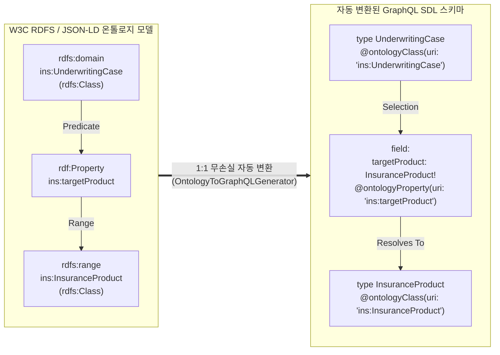
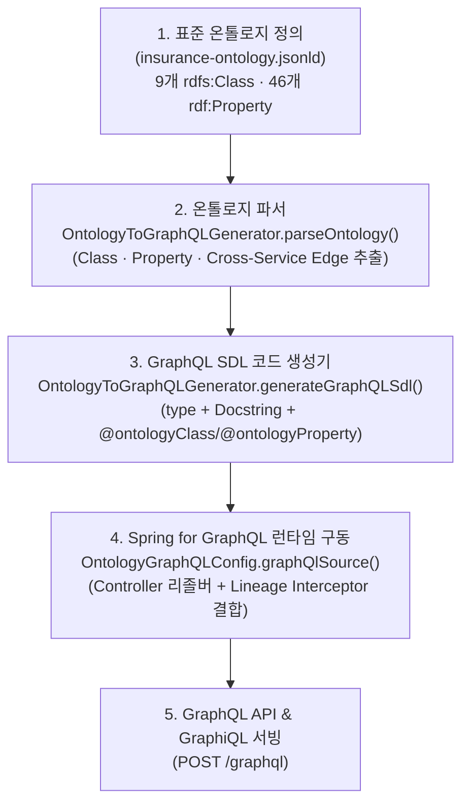

# Chapter 07. Ontology와 GraphQL의 시너지: 스키마 자동 변환

> **학습 목표**
> 1. **온톨로지(Ontology: RDF / RDFS / JSON-LD)**와 **GraphQL Schema(SDL)**가 왜 수학적·구조적으로 완벽한 1:1 대칭(Isomorphism)을 이루는지 이해한다.
> 2. 표준 JSON-LD 온톨로지 정의로부터 **GraphQL 스키마(`type`, `field`, `@ontologyClass`, `@ontologyProperty` 디렉티브)**를 **자동 변환(Auto-Generation)**하는 아키텍처와 알고리즘을 파악한다.
> 3. 본 워크스페이스의 [`OntologyToGraphQLGenerator.java`](../backend/src/main/java/com/insure/ontology/generator/OntologyToGraphQLGenerator.java) 구현 코드와 `curl` 예제를 통해 온톨로지 진화와 데이터 계보(Data Lineage) 추적을 실증한다.

---

## 1. 왜 Ontology와 GraphQL은 천생연분인가?

엔터프라이즈 기업(특히 금융, 보험, 의료, 커머스)에는 수많은 레거시 시스템과 마이크로서비스가 존재합니다.
- 상품 시스템에서는 보험상품 코드를 `prod_id`라고 부르고,
- 언더라이팅 시스템에서는 `target_prod_id`라고 부르며,
- 리스크 시스템에서는 위험점수를 `tot_risk_scr`이라는 축약된 물리 컬럼명으로 저장합니다.

이를 비즈니스 관점의 표준 개념으로 통합 정의한 지식 모델이 바로 **온톨로지(Ontology — W3C 표준 RDF / RDFS / OWL / JSON-LD)**입니다.  
그런데 온톨로지를 구축해 놓아도, 실제 애플리케이션 개발자들이 이를 API로 소비하려면 다시 수작업으로 DTO와 API 명세를 만들어야 하는 단절이 존재했습니다. **이 단절을 완벽하게 이어주는 다리가 바로 GraphQL입니다.**

### 1.1 구조적 동형성 (Structural Isomorphism): Triple vs GraphQL Field

온톨로지(RDFS)는 세상의 모든 지식을 **`Subject(주어 / Domain) — Predicate(술어 / Property) — Object(목적어 / Range)`**라는 방향성 그래프(Directed Labeled Graph)로 표현합니다.

놀랍게도 GraphQL 스키마 역시 **`Object Type(주어) — Field(술어) — Field Return Type(목적어)`**이라는 완전히 동일한 그래프 구조를 가집니다!



### 1.2 Ontology 개념 ↔ GraphQL 스키마 요소 1:1 매핑 규칙

| 온톨로지 (JSON-LD / RDFS / XSD) 요소 | 변환되는 GraphQL SDL 요소 | 설명 및 변환 예시 |
| :--- | :--- | :--- |
| **`rdfs:Class`** (`@type: "rdfs:Class"`) | **`type <ClassName>`** | 예: `ins:InsuranceProduct` → `type InsuranceProduct` |
| **`rdf:Property`** (`@type: "rdf:Property"`) | **`<fieldName>: <Type>`** | 예: `ins:productName` → `productName: String!` |
| **`rdfs:domain`** (속성이 속한 클래스) | 해당 필드가 선언될 **소속 `type`** | `rdfs:domain: "ins:InsuranceProduct"` → `type InsuranceProduct { ... }` 내부에 필드 배치 |
| **`rdfs:range`가 `xsd:*` 원시 타입인 경우** (Datatype Property) | **GraphQL Scalar 타입** (`ID`, `String`, `Int`, `Float`, `Boolean`) | - `xsd:ID` → `ID`<br>- `xsd:string`, `xsd:date` → `String`<br>- `xsd:int`, `xsd:integer` → `Int`<br>- `xsd:float`, `xsd:double` → `Float`<br>- `xsd:boolean` → `Boolean` |
| **`rdfs:range`가 다른 `rdfs:Class`인 경우** (Object Property) | **GraphQL Object Type 참조** (하위 `@SchemaMapping` 간선) | `rdfs:range: "ins:InsuranceProduct"` → `targetProduct: InsuranceProduct!` |
| **`ins:isList`** & **`ins:required`** 제약조건 | 리스트 **`[...]`** 및 Non-Null **`!`** 조합 | - `isList=true, required=true` → `[Coverage!]!`<br>- `isList=false, required=true` → `String!` |
| **`rdfs:label`** & **`rdfs:comment`** | **GraphQL Docstring (`"""..."""`)** | GraphiQL 문서 및 AI 프롬프트 컨텍스트로 자동 주입 |
| **온톨로지 URI 및 원천 매핑 메타데이터** (`@id`, `sourceService`, `sourceField`) | **Custom Directives** (`@ontologyClass`, `@ontologyProperty`) | 런타임 데이터 계보(Lineage) 추적 및 마이크로서비스 라우팅 힌트로 보존 |

---

## 2. 온톨로지 → GraphQL 스키마 자동 변환 파이프라인

본 워크스페이스의 [`backend/`](../backend)는 **JSON-LD 온톨로지 파일 하나만 수정하면 서버 기동 시(또는 런타임 API 호출 시) GraphQL SDL이 자동으로 도출되고 즉시 `GraphQlSource`에 반영되는 아키텍처**를 구현하고 있습니다.



---

## 3. 실제 코드로 보는 온톨로지 → GraphQL SDL 자동 변환

### 3.1 입력: JSON-LD 온톨로지 원본 ([`insurance-ontology.jsonld`](../backend/src/main/resources/ontology/insurance-ontology.jsonld))

JSON-LD 파일에 정의된 `ins:UnderwritingCase` 클래스와 `ins:targetProduct` 속성의 일부를 발췌한 것입니다.

```json
{
  "@context": {
    "rdf": "http://www.w3.org/1999/02/22-rdf-syntax-ns#",
    "rdfs": "http://www.w3.org/2000/01/rdf-schema#",
    "xsd": "http://www.w3.org/2001/XMLSchema#",
    "ins": "http://schema.insure.com/ontology#"
  },
  "@graph": [
    {
      "@id": "ins:UnderwritingCase",
      "@type": "rdfs:Class",
      "rdfs:label": "언더라이팅 심사건",
      "rdfs:comment": "청약자의 특정 보험상품 가입 신청에 대해 위험평가 및 인수심사 규칙을 적용하는 심사 케이스",
      "ins:domain": "Underwriting",
      "ins:sourceService": "underwriting-decision-service",
      "ins:sourceEndpoint": "/mock/uw-service/cases"
    },
    {
      "@id": "ins:caseId",
      "@type": "rdf:Property",
      "rdfs:label": "심사건 ID",
      "rdfs:comment": "언더라이팅 심사 케이스 고유 식별자",
      "rdfs:domain": "ins:UnderwritingCase",
      "rdfs:range": "xsd:ID",
      "ins:required": true,
      "ins:sourceField": "uw_case_id"
    },
    {
      "@id": "ins:targetProduct",
      "@type": "rdf:Property",
      "rdfs:label": "청약 대상 상품",
      "rdfs:comment": "심사 대상이 되는 보험상품 엔티티 참조 (Product 서비스 조인)",
      "rdfs:domain": "ins:UnderwritingCase",
      "rdfs:range": "ins:InsuranceProduct",
      "ins:required": true,
      "ins:sourceField": "target_prod_id",
      "ins:crossServiceJoin": "product-catalog-service"
    }
  ]
}
```

### 3.2 변환 엔진: Java 구현 코드 ([`OntologyToGraphQLGenerator.java`](../backend/src/main/java/com/insure/ontology/generator/OntologyToGraphQLGenerator.java))

위 JSON-LD를 읽어 GraphQL 타입 표현식과 디렉티브를 생성하는 핵심 메서드입니다.

```java
public static String mapRangeToGraphQLType(String rangeUri) {
    return switch (rangeUri) {
        case "xsd:ID" -> "ID";
        case "xsd:string", "xsd:date", "xsd:dateTime" -> "String";
        case "xsd:int", "xsd:integer", "xsd:long" -> "Int";
        case "xsd:float", "xsd:double", "xsd:decimal" -> "Float";
        case "xsd:boolean" -> "Boolean";
        default -> extractLocalName(rangeUri); // 예: "ins:InsuranceProduct" -> "InsuranceProduct"
    };
}

private static String buildGraphQLTypeExpression(String baseType, boolean isList, boolean required) {
    if (isList) {
        return required ? "[" + baseType + "!]!" : "[" + baseType + "!]";
    }
    return required ? baseType + "!" : baseType;
}
```

### 3.3 출력: 자동 생성된 GraphQL SDL ([`schema.graphql`](../backend/src/main/resources/schema.graphql))

변환기가 자동으로 만들어낸 GraphQL 스키마 결과물입니다.

```graphql
"""
[Underwriting Domain] 언더라이팅 심사건
청약자의 특정 보험상품 가입 신청에 대해 위험평가 및 인수심사 규칙을 적용하는 심사 케이스
Ontology RDFS Class: ins:UnderwritingCase
Source Service: underwriting-decision-service (/mock/uw-service/cases)
"""
type UnderwritingCase @ontologyClass(
  uri: "ins:UnderwritingCase"
  label: "언더라이팅 심사건"
  domain: "Underwriting"
  sourceService: "underwriting-decision-service"
  sourceEndpoint: "/mock/uw-service/cases"
) {
  """심사건 ID - 언더라이팅 심사 케이스 고유 식별자"""
  caseId: ID! @ontologyProperty(uri: "ins:caseId", label: "심사건 ID", range: "xsd:ID", sourceField: "uw_case_id")

  """청약 대상 상품 - 심사 대상이 되는 보험상품 엔티티 참조 (Product 서비스 조인)"""
  targetProduct: InsuranceProduct! @ontologyProperty(
    uri: "ins:targetProduct",
    label: "청약 대상 상품",
    range: "ins:InsuranceProduct",
    sourceField: "target_prod_id",
    crossServiceJoin: "product-catalog-service"
  )
}
```

---

## 4. 온톨로지 + GraphQL 결합의 실무적 가치: 실시간 데이터 계보(Data Lineage) 추적

온톨로지의 시맨틱 정보(`@ontologyClass`, `@ontologyProperty`)가 GraphQL 스키마에 내장되어 있기 때문에, 클라이언트가 GraphQL 쿼리를 실행할 때마다 **"응답의 각 필드가 어떤 온톨로지 URI 개념에서 유래했고, 어느 마이크로서비스의 어떤 물리 컬럼(`rawSourceFields`)을 조회해 왔는지"** 실시간 데이터 계보(Lineage)를 100% 추적할 수 있습니다.

### `curl` 예제: GraphQL 쿼리 실행과 동시에 온톨로지 데이터 계보(`extensions.ontologyLineage`) 확인하기

```bash
curl -X POST http://localhost:8080/graphql \
  -H "Content-Type: application/json" \
  -d '{
    "query": "query { underwritingCase(caseId: \"UW-CASE-2026-002\") { caseId uwStatus targetProduct { productId productName } targetApplicant { applicantId applicantName } } }"
  }'
```

#### 응답 JSON (`data` + `extensions.ontologyLineage`)
```json
{
  "data": {
    "underwritingCase": {
      "caseId": "UW-CASE-2026-002",
      "uwStatus": "SUBSTANDARD_REVIEW",
      "targetProduct": {
        "productId": "PROD-HLT-001",
        "productName": "무배당 시그니처 100세 종합건강보험"
      },
      "targetApplicant": {
        "applicantId": "APPL-1002",
        "applicantName": "박서연"
      }
    }
  },
  "extensions": {
    "totalBackendCalls": 3,
    "ontologyLineage": [
      {
        "stepOrder": 1,
        "graphqlFieldPath": "Query.underwritingCase",
        "ontologyClassUri": "ins:UnderwritingCase",
        "ontologyPropertyUri": "ins:caseId,ins:uwStatus,ins:decision",
        "domainName": "Underwriting",
        "sourceService": "underwriting-decision-service",
        "httpMethod": "GET",
        "endpointUri": "/mock/uw-service/cases/UW-CASE-2026-002",
        "rawSourceFields": ["uw_case_id", "uw_sts_cd", "target_prod_id", "target_appl_id"],
        "latencyMs": 12,
        "status": "SUCCESS"
      },
      {
        "stepOrder": 2,
        "graphqlFieldPath": "UnderwritingCase(UW-CASE-2026-002).targetProduct",
        "ontologyClassUri": "ins:InsuranceProduct",
        "ontologyPropertyUri": "ins:targetProduct",
        "domainName": "Product",
        "sourceService": "product-catalog-service",
        "httpMethod": "GET",
        "endpointUri": "/mock/product-service/products/PROD-HLT-001",
        "rawSourceFields": ["prod_id", "prod_nm", "prod_cat_cd", "base_mm_prem"],
        "latencyMs": 8,
        "status": "SUCCESS"
      },
      {
        "stepOrder": 3,
        "graphqlFieldPath": "UnderwritingCase(UW-CASE-2026-002).targetApplicant",
        "ontologyClassUri": "ins:ApplicantProfile",
        "ontologyPropertyUri": "ins:targetApplicant",
        "domainName": "Risk",
        "sourceService": "risk-assessment-service",
        "httpMethod": "GET",
        "endpointUri": "/mock/risk-service/applicants/APPL-1002",
        "rawSourceFields": ["appl_id", "appl_nm", "ins_age", "tot_risk_scr"],
        "latencyMs": 15,
        "status": "SUCCESS"
      }
    ]
  }
}
```

---

> **다음 챕터 예고**: 온톨로지에서 도출된 이 풍부한 GraphQL 스키마(`schema.graphql`)를 **생성형 AI(LLM / 코딩 에이전트)**에게 주면 어떤 일이 벌어질까요? 마지막 챕터인 [Chapter 08. AI와 GraphQL: 왜 AI에게 스키마를 주면 코드를 잘 만드는가?](./08-graphql-and-ai.md)에서 그 비밀을 해부합니다.
