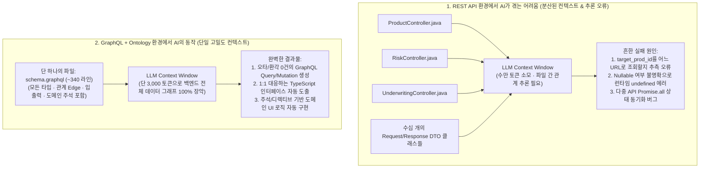
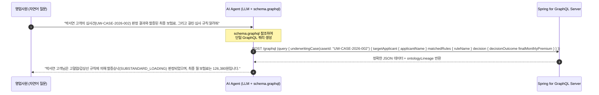

# Chapter 08. AI와 GraphQL: 왜 AI에게 GraphQL 스키마를 주면 코드를 잘 만드는가?

> **학습 목표**
> 1. **AI 코딩 에이전트(Claude, Gemini, GPT 등)**에게 백엔드와 연동되는 애플리케이션을 만들게 할 때, 왜 **REST API보다 GraphQL 스키마(`schema.graphql`)가 압도적으로 높은 코드 생성 정확도**를 보이는지 5가지 기술적 원인을 이해한다.
> 2. 본 프로젝트에서 [`schema.graphql`](../backend/src/main/resources/schema.graphql) 파일 하나만을 입력으로 삼아 영업사원용 언더라이팅 워크벤치([`sales-frontend/`](../sales-frontend)) 전체를 단번에 생성한 실제 사례를 분석한다.
> 3. 코드 생성을 넘어 **런타임 AI 에이전트(Text-to-GraphQL / Tool Calling)**에서 GraphQL이 왜 Text-to-SQL이나 다중 REST Tool보다 안전하고 정확한지 파악한다.

---

## 1. AI 코딩 에이전트 관점에서의 REST vs GraphQL

개발자가 AI에게 **"현재 백엔드 API에 맞춰 영업사원용 인수심사 프론트엔드 화면을 만들어줘"**라고 요청했을 때, AI 내부(LLM Context Window)에서 일어나는 일을 비교해 봅시다.



---

## 2. GraphQL 스키마를 주면 AI가 코드를 완벽하게 짜는 5가지 이유

### 이유 ①: 최고 밀도의 단일 진실 공급원 (High-Density Single Source of Truth)

LLM의 성능은 **"제한된 컨텍스트 윈도우 안에 얼마나 노이즈 없이 핵심 구조 정보를 압축해서 넣어주느냐(Signal-to-Noise Ratio)"**에 비례합니다.

- **OpenAPI(Swagger) JSON/YAML**: 중괄호와 반복적인 HTTP 보일러플레이트(`responses`, `200`, `content`, `application/json`, `$ref`)가 너무 많아 스펙 파일 하나가 수만 줄에 달하며 토큰 효율이 극도로 낮습니다.
- **GraphQL SDL (`schema.graphql`)**: 불필요한 보일러플레이트 없이 **순수한 타입, 필드, 인자, 설명만 가장 간결한 문법으로 응축**되어 있습니다. 본 프로젝트의 3개 도메인(9개 엔티티, 46개 속성, 9개 Query, 1개 Mutation) 전체가 단 **345줄**에 모두 들어갑니다. AI가 단 한 번의 파일 읽기로 백엔드 전체를 오해 없이 100% 이해합니다.

---

### 이유 ②: 외래키 추측이 필요 없는 '명시적 관계 그래프 (Explicit Graph Edges)'

REST API에서는 심사건 DTO에 `targetProductId: String`이라는 필드만 달랑 들어 있습니다. AI는 이 ID를 가지고 `/api/v1/products/{id}`를 호출해야 하는지, `/api/catalog?productId={id}`를 호출해야 하는지 코드를 뒤져서 추론해야 합니다.

반면 GraphQL 스키마에는 **노드와 노드를 잇는 간선(Edge)이 타입으로 직접 선언**되어 있습니다:

```graphql
type UnderwritingCase {
  caseId: ID!
  targetProduct: InsuranceProduct!      # ← 어떤 타입으로 이어지는지 100% 명시됨!
  targetApplicant: ApplicantProfile!    # ← 별도 API 호출 없이 중첩 선택만 하면 됨!
  matchedRules: [UnderwritingRule!]!
  decision: UnderwritingDecision!
}
```
AI는 클라이언트 단에서 복잡한 Join 코드나 다중 `useEffect` 연쇄 호출을 짤 필요가 전혀 없습니다. 그저 화면에 필요한 깊이만큼 중괄호(`{ ... }`)를 열어 한 번에 요청하는 깔끔한 코드를 생성합니다.

---

### 이유 ③: 엄격한 정적 타입과 Nullability 계약(`!`)을 통한 컴파일 무결성

AI가 생성한 프론트엔드 코드에서 가장 흔히 발생하는 런타임 버그는 `Cannot read properties of undefined (reading 'map')`입니다.

GraphQL 스키마는 **`[Coverage!]!`**처럼 리스트 자체와 원소의 Null 가능 여부를 느낌표(`!`)로 완벽히 명시합니다.
- AI는 이를 보고 TypeScript 인터페이스([`sales-frontend/src/types.ts`](../sales-frontend/src/types.ts))를 생성할 때 어떤 필드가 `string`이고 어떤 필드가 `string | null`인지 정확하게 구분합니다.
- 실제로 본 프로젝트의 [`sales-frontend/`](../sales-frontend)는 AI가 `schema.graphql`만 보고 생성한 뒤 단 한 번의 수정 없이 `tsc -b && vite build`를 무결점으로 통과했습니다.

---

### 이유 ④: 도메인 독스트링(`"""..."""`)과 시맨틱 디렉티브(`@ontologyProperty`)의 시너지

단순히 필드 이름(`sensitiveRiskCategory: String!`)만 있는 스키마보다, **온톨로지로부터 자동 생성된 도메인 설명과 디렉티브**가 결합될 때 AI의 진가가 폭발합니다.

본 프로젝트의 [`schema.graphql`](../backend/src/main/resources/schema.graphql)에 포함된 실제 필드 정의를 보십시오:

```graphql
type InsuranceProduct {
  """기본 월보험료(원) - 40세 표준체 기준 월 기본 보험료"""
  baseMonthlyPremium: Int! @ontologyProperty(uri: "ins:baseMonthlyPremium", label: "기본 월보험료(원)", range: "xsd:integer", sourceField: "base_mm_prem")

  """인수심사 트랙 - STANDARD(표준체 심사), SIMPLIFIED_325(3·2·5 유병자 간편심사), DRIVER_CARE(운전자 심사)"""
  underwritingTrack: String! @ontologyProperty(uri: "ins:underwritingTrack", label: "인수심사 트랙", range: "xsd:string", sourceField: "uw_track_cd")
}

type Coverage {
  """최대 가입금액(만원) - 담보별 최대 가입 한도액(만원 단위)"""
  maxCoverageAmount: Int! @ontologyProperty(uri: "ins:maxCoverageAmount", label: "최대 가입금액(만원)", range: "xsd:integer", sourceField: "max_cov_amt")

  """민감 위험분류 - 해당 담보 인수 시 중점 심사하는 위험 카테고리 (CARDIOVASCULAR, ENDOCRINE, OCCUPATIONAL, DRIVING, CANCER)"""
  sensitiveRiskCategory: String! @ontologyProperty(uri: "ins:sensitiveRiskCategory", label: "민감 위험분류", range: "xsd:string", sourceField: "sens_risk_cat")
}
```

AI는 이 스키마를 읽고 **별도의 상세 화면 기획서 없이도** 다음 3가지 고급 비즈니스 UI 로직을 스스로 설계·구현해 냈습니다:

1. **단위(원 vs 만원) 자동 구분 포매팅**:
   - `baseMonthlyPremium`은 주석에 `(원)`이라고 되어 있으므로 `89,000원` 포매터를 적용하고, `maxCoverageAmount`는 `(만원)`이라고 되어 있으므로 `5,000만원`(`formatManwon`) 포매터를 정확히 구분해 적용했습니다.
2. **고객 위험요소 ↔ 담보 민감 위험분류 자동 교차 하이라이트**:
   - 고객이 고지한 `RiskFactor.riskCategory`(예: `CARDIOVASCULAR`)와 상품 담보의 `Coverage.sensitiveRiskCategory`가 동일한 도메인 값 체계를 쓴다는 것을 스키마 주석에서 파악하고, 두 값이 일치할 때 화면에 **"고객 고지 위험요소 연동 심사 대상"** 경고 배지를 자동으로 렌더링했습니다.
3. **표준형 인수거절 시 3·2·5 유병자 간편보험 대안 추천 워크플로우**:
   - `underwritingTrack`의 주석(`STANDARD`, `SIMPLIFIED_325`)과 `decisionOutcome`의 주석(`DECLINED`, `SUBSTANDARD_LOADING`)을 연결하여, 표준형 상품 심사에서 거절/할증이 나오면 **"3·2·5 유병자 간편건강보험으로 원클릭 전환 비교 심사"** 버튼을 띄우는 영업 가이드를 스스로 구현했습니다.

---

### 이유 ⑤: 런타임 AI 에이전트 (Text-to-GraphQL & MCP Tool Calling)에 최적화

AI를 코딩 도우미로 쓰는 것을 넘어, **서비스 내부에서 고객이나 임직원의 자연어 질문을 받아 백엔드 데이터를 조회·실행하는 AI Agent**를 만들 때도 GraphQL은 최고의 무기입니다.

| 비교 항목 | Text-to-SQL (DB 직접 조회) | REST API Tool Calling (수십 개 함수 등록) | **Text-to-GraphQL (GraphQL 단일 Tool)** |
| :--- | :--- | :--- | :--- |
| **보안성 및 권한 제어** | 테이블/컬럼 전체가 노출되기 쉬우며 Row/Field 권한 제어가 매우 위험함 | 엔드포인트별 권한은 가능하나 조합 시 누락 위험 | 스키마에 노출된 필드만 접근 가능하며, **Chapter 06에서 배운 `@PreAuthorize` 필드/객체 보안이 100% 그대로 작동함!** |
| **다중 도메인 조인** | 물리 테이블명(`tb_uw_case_m`)과 복잡한 외래키 Join을 AI가 틀리기 쉬움 | AI가 1번 Tool 호출 → 결과 보고 2번 Tool 호출 → 3번 Tool 호출 (지연시간 3~5배 증가) | AI가 **단 1개의 GraphQL 쿼리**를 작성해 한 번에 다중 마이크로서비스 데이터를 조회! |
| **실행 전 오류 검증** | 실제 DB에 쿼리를 날려봐야 문법/컬럼 오류를 알 수 있음 | 파라미터 누락 시 런타임 HTTP 400/500 발생 | GraphQL 엔진이 실행 전 **AST Validation**으로 잘못된 필드/타입을 0ms 만에 잡아내어 AI가 즉시 자가 수정(Self-Correction) 가능! |



---

## 3. AI + GraphQL 활용 시 실무 주의사항 (Caveats)

AI와 GraphQL의 궁합이 아무리 뛰어나더라도, 실무에서는 다음 3가지 원칙을 반드시 지켜야 합니다(자세한 분석은 [`docs/sales_frontend_graphql_ai_report.md`](../docs/sales_frontend_graphql_ai_report.md) 참조):

1. **암묵적 비즈니스 계산식(Implicit Business Formula)은 반드시 서버 Mutation을 단일 진실 공급원(SSOT)으로 삼을 것**:
   - `schema.graphql`은 데이터 구조와 입출력 계약을 알려주지만, 세부적인 보험수리 계산식(나이·BMI·직업급수별 정밀 가산점 산식 등)은 백엔드 서비스 내부에 있습니다.
   - AI가 프론트엔드에서 어림짐작으로 계산식을 짜게 두지 말고, 핵심 판정과 보험료 산출은 반드시 서버의 `simulateUnderwriting` Mutation 결과를 신뢰하도록 프롬프트에 명시해야 합니다.
2. **상태 코드나 카테고리는 가능한 한 `String` 대신 명시적 `enum`으로 스키마에 선언할 것**:
   - 허용되는 값 목록이 스키마의 `enum`으로 선언되어 있으면 AI가 `switch-case`나 배지 컬러 매핑을 짤 때 단 하나의 케이스도 빠뜨리지 않습니다.
3. **도메인 전문가 및 컴플라이언스 검수**:
   - AI가 스키마를 보고 순식간에 그럴듯한 UI와 약관 안내 문구를 만들어내더라도, 금융/의료/법률 등 규제 산업에서는 필수 고지 문구와 권한 처리가 법적 요건을 충족하는지 최종 확인해야 합니다.

---

## 세미나 전체 요약 (Key Takeaways)

1. **GraphQL의 본질 ([Ch 01](./01-graphql-introduction.md) ~ [Ch 03](./03-graphql-schema-and-operations.md))**:
   - GraphQL은 비즈니스 도메인을 **정점(`type`)과 간선(`field`)의 그래프**로 모델링하여, 클라이언트가 단일 엔드포인트(`POST /graphql`)에서 원하는 부분 그래프(Subgraph)만 정확히 추출하는 표준 쿼리 언어다.
2. **실무 트레이드오프와 하이브리드 전략 ([Ch 04](./04-graphql-caveats-and-best-practices.md))**:
   - N+1 문제는 **`@BatchMapping`(DataLoader)**으로 해결하고, 스키마 변경은 **`@deprecated`와 GraphQL Inspector/Hive**로 관리하며, CDN 캐싱이나 파일 스트리밍이 필요한 영역에는 **REST API를 함께 쓰는 하이브리드 아키텍처**가 정답이다.
3. **Spring for GraphQL & Security ([Ch 05](./05-spring-for-graphql-deep-dive.md) ~ [Ch 06](./06-spring-graphql-security.md))**:
   - 기존 `@Service` 계층을 그대로 재사용하면서 `@QueryMapping`, `@MutationMapping`, `@SchemaMapping`, `@BatchMapping`으로 그래프를 조립하고, DB Join이 필요한 경우 **`DataFetchingFieldSelectionSet`**으로 동적 `JOIN FETCH`를 수행한다.
   - 보안은 `/graphql`을 열어두되 **`@EnableMethodSecurity`(`@PreAuthorize`, `@PostAuthorize`)**를 통해 쿼리/뮤테이션/개별 필드 단위로 정밀하게 인가한다.
4. **Ontology & AI 시대의 핵심 인프라 ([Ch 07](./07-graphql-and-ontology.md) ~ [Ch 08](./08-graphql-and-ai.md))**:
   - 기업의 표준 **온톨로지(JSON-LD/RDFS)**로부터 GraphQL 스키마를 자동 생성할 수 있으며, 이렇게 생성된 시맨틱 GraphQL 스키마는 **AI 코딩 에이전트와 런타임 AI 에이전트의 생산성과 정확도를 극대화하는 최고의 컨텍스트 계약서**가 된다.
