# GraphQL 기술 세미나: 개념부터 Spring for GraphQL, Security, Ontology & AI 활용까지

본 디렉토리는 **GraphQL 기술 세미나**를 위한 종합 강의 문서입니다.  
GraphQL의 탄생 배경과 철학부터 스키마 설계, 실무 운영 시 주의사항(N+1, 캐싱, 버전 관리), **Spring Boot + Spring for GraphQL** 기반의 서버 구현 및 최적화, **Spring Security** 연동, 그리고 최신 트렌드인 **온톨로지(Ontology) 스키마 자동 변환**과 **AI(LLM) 기반 개발 생산성 극대화**까지 전 과정을 다룹니다.

> **실습 및 예제 기준 환경**
> - **Client 요청 예제**: `curl` (HTTP POST JSON 페이로드 기반)
> - **Server 구현 예제**: Java 17+, Spring Boot 3.x, Spring for GraphQL, Spring Security 6.x
> - **다이어그램**: Mermaid (`flowchart`, `sequenceDiagram`, `classDiagram`, `erDiagram`)
> - **실증 레퍼런스 프로젝트**: 본 워크스페이스의 [`backend/`](../backend) 및 [`sales-frontend/`](../sales-frontend) (`Ontology2GraphQL` PoC)
> - **발표용 HTML 슬라이드 (Part 1 — Ch 01 ~ Ch 03)**: [`slides-part1-ch01-03.html`](./slides-part1-ch01-03.html) *(브라우저에서 바로 열어 발표 및 독학 가능)*

---

## 전체 학습 로드맵

```mermaid
flowchart LR
    subgraph Part1["Part 1. GraphQL 기초와 설계"]
        C1["Ch 01. GraphQL 소개\n(Graph의 의미 · 표준 · 도입 기업)"]
        C2["Ch 02. GraphQL 특징과 장점\n(Single Endpoint · Over/Under-fetching 해결)"]
        C3["Ch 03. GraphQL Schema 완벽 가이드\n(Type · Input · Query · Mutation · Directive)"]
    end

    subgraph Part2["Part 2. 아키텍처 주의사항과 Spring 실전"]
        C4["Ch 04. GraphQL 주의사항\n(N+1 · Batch · Deprecation · REST 하이브리드)"]
        C5["Ch 05. Spring for GraphQL 심화\n(아키텍처 · 어노테이션 · 동적 Join 최적화 · Test)"]
        C6["Ch 06. Spring GraphQL Security\n(인증/인가 · RBAC · 필드/객체 단위 권한 제어)"]
    end

    subgraph Part3["Part 3. 차세대 확장: Ontology & AI"]
        C7["Ch 07. Ontology와 GraphQL\n(JSON-LD/RDFS → GraphQL 스키마 자동 변환)"]
        C8["Ch 08. AI와 GraphQL의 시너지\n(왜 AI에게 스키마를 주면 코드를 잘 짜는가?)"]
    end

    C1 --> C2 --> C3 --> C4 --> C5 --> C6 --> C7 --> C8
```

---

## 목차 (Table of Contents)

### [Chapter 01. GraphQL의 소개](./01-graphql-introduction.md)
1. **왜 이름이 GraphQL인가? Graph와 무슨 관계인가?**
   - 비즈니스 도메인 멘탈 모델로서의 그래프(Node와 Edge)
   - SQL(테이블 중심) vs GraphQL(애플리케이션 객체 그래프 탐색 중심)
   - 흔한 오해: "GraphQL을 쓰려면 Graph DB(Neo4j 등)가 필요한가요?"
2. **GraphQL 표준(Specification)은 어디에 정의되어 있는가?**
   - Meta(Facebook)의 탄생 배경(2012)부터 GraphQL Foundation(Linux Foundation 산하) 이관까지
   - 두 개의 핵심 표준: **GraphQL Query Language Spec (`spec.graphql.org`)** 과 **GraphQL over HTTP Spec**
   - 스펙 진화 프로세스(RFC Stage 0 ~ 3)와 구현체 생태계(`graphql-java`, `Apollo`, `Relay`)
3. **Netflix를 포함해 GraphQL을 잘 사용하는 글로벌/국내 기업 사례**
   - **Netflix**: 수백 개의 마이크로서비스를 **Federated GraphQL (DGS & Spring for GraphQL)** 로 통합한 과정
   - **GitHub**: REST API v3에서 GraphQL API v4로 전환한 기술적 이유
   - **Meta, Shopify, Airbnb, PayPal** 및 국내 테크 기업 활용 패턴

---

### [Chapter 02. GraphQL의 핵심 특징과 장점](./02-graphql-features-and-pros.md)
1. **Single Endpoint (`POST /graphql`) 아키텍처**
   - 리소스별 다중 URI(`GET /users`, `GET /orders`)를 갖는 REST와 단일 엔드포인트 GraphQL의 근본적 차이
   - BFF(Backend For Frontend) 및 API Gateway로서의 역할
2. **GraphQL이 해결하는 핵심 문제와 장점들**
   - **Over-fetching 방지**: 화면에 필요한 필드만 정확히 선택(Field Projection)
   - **Under-fetching & N+1 네트워크 왕복(Waterfall) 해결**: 단일 요청으로 다중 도메인 트리 조립
   - **강력한 타입 시스템(Strongly Typed Schema)**: 프론트엔드-백엔드 간 명확한 Contract-First 협업
   - **Introspection & 자체 문서화(Self-Documenting)**: GraphiQL을 통한 실시간 스키마 탐색과 코드 자동 생성
   - **부분 성공(Partial Success) 메커니즘**: `data`와 `errors`의 공존을 통한 장애 격리
3. **`curl`과 Spring Boot로 확인하는 GraphQL 요청/응답 해부**

---

### [Chapter 03. GraphQL Schema 완벽 가이드](./03-graphql-schema-and-operations.md)
1. **SDL(Schema Definition Language) 핵심 구성요소**
   - Scalar 타입(`ID`, `String`, `Int`, `Float`, `Boolean`, Custom Scalar)과 Nullability(`!`), 배열(`[T!]!`)의 4가지 조합 의미
   - **`type`(Object Type) vs `input`(Input Object Type)**: 왜 출력 타입과 입력 타입을 엄격히 분리하는가?
   - **`Query`(읽기) vs `Mutation`(쓰기/상태 변경)**: 병렬 실행 보장(Query)과 순차 실행 보장(Mutation)의 차이
   - **`directive`(디렉티브)**: 실행 제어(`@include`, `@skip`), 스키마 메타데이터(`@deprecated`, `@specifiedBy`), 커스텀 디렉티브(`directive @ontologyProperty`, `directive @auth`)
   - 고급 타입: `enum`, `interface`, `union`
2. **실전 Query & Mutation 작성 및 실행 예제**
   - Arguments, Variables(`$input`), Aliases, Fragments 활용법
   - **`curl` 클라이언트 호출 예제** 및 **Spring for GraphQL 서버 구현 코드**

---

### [Chapter 04. GraphQL 실무 주의사항 및 아키텍처 트레이드오프](./04-graphql-caveats-and-best-practices.md)
1. **N+1 문제(N+1 Query Problem)와 Batch Processing**
   - 필드 단위 독립 리졸버 구조에서 N+1이 발생하는 정확한 원리 (Mermaid 시퀀스 분석)
   - **DataLoader 패턴과 `@BatchMapping`**: 요청 단위 키 수집(Batching) 및 중복 제거(Caching)
   - 본 프로젝트 실증 비교: **16회 백엔드 호출(`underwritingCases`) vs 4회 배치 호출(`underwritingCasesBatched`)**
2. **스키마 진화(Deprecation)와 오픈소스 버전 관리 도구**
   - 버전 없는 API(Versionless API)를 유지하는 `@deprecated(reason: "...")` 전략과 필드 삭제 라이프사이클
   - 주요 오픈소스 스키마 거버넌스 도구 비교: **GraphQL Inspector**, **GraphQL Hive**, **Apollo Rover / WunderGraph Cosmo**
3. **HTTP 캐싱 등이 필요한 경우 REST API가 여전히 유효한 이유 (Hybrid 전략)**
   - GraphQL(`POST /graphql`)이 CDN/HTTP 캐싱, 파일 스트리밍, 단순 웹훅에서 불리한 이유
   - Persisted Queries(APQ)의 개념과 한계
   - **REST + GraphQL 하이브리드 아키텍처 의사결정 가이드**
4. **쿼리 복잡도/깊이 제한(`MaxQueryDepth`, `MaxQueryComplexity`)을 통한 서버 보호**

---

### [Chapter 05. Spring for GraphQL 심화 가이드](./05-spring-for-graphql-deep-dive.md)
1. **Spring for GraphQL 아키텍처 소개**
   - `graphql-java` 엔진과 Spring Boot 3의 결합 구조
   - Controller, Service, Repository 계층에 GraphQL이 녹아 들어가는 방식 (기존 서비스 레이어 100% 재사용)
2. **핵심 어노테이션 완벽 정리 및 예제**
   - `@QueryMapping`, `@MutationMapping`, `@SchemaMapping`, `@BatchMapping`, `@Argument`, `@ContextValue`
3. **실무 성능 최적화: 특정 Join을 타야 하는 경우의 동적 쿼리 최적화**
   - `@BatchMapping`만으로는 부족한 케이스: 루트 조회 시점에 `JOIN FETCH` 여부를 결정해야 할 때
   - **`DataFetchingFieldSelectionSet` 활용**: 클라이언트가 요청한 하위 필드를 감지하여 JPA/QueryDSL 동적 Join(`JOIN FETCH`)을 수행하는 실전 코드
4. **Unit Test & Integration Test 작성법**
   - `@GraphQlTest` 기반 슬라이스 단위 테스트 및 `@AutoConfigureGraphQlTester` 통합 테스트

---

### [Chapter 06. Spring for GraphQL Security (인증과 인가)](./06-spring-graphql-security.md)
1. **왜 GraphQL 보안은 REST 보안과 접근 방식이 다른가?**
   - 단일 엔드포인트(`POST /graphql`)에서 URL 패턴 매칭(`requestMatchers`)이 무력화되는 이유
   - HTTP 필터 레벨 인증(Authentication) + 리졸버 메서드 레벨 인가(Authorization) 결합 아키텍처
2. **Spring Security 연동 설정 (`SecurityFilterChain` + `@EnableMethodSecurity`)**
3. **케이스별 Authentication & Authorization 상세 구현 예제 (`curl` + Java)**
   - **Case 1**: Public Query vs 인증 필수 Query (`isAuthenticated()`)
   - **Case 2**: 역할 기반 인가 (RBAC — `hasRole('UNDERWRITER')`, `hasAuthority(...)`)
   - **Case 3**: **필드 레벨 보안 (Field-Level Security)** — 일반 유저에게는 민감 필드(`medicalHistory`, `salary`)만 차단하고 나머지 필드는 정상 반환(Partial Data)하기
   - **Case 4**: 객체 소유권 기반 인가 (ABAC — 본인 데이터 또는 담당 건만 조회: `#id == authentication.name`, `@PostAuthorize`)
   - **Case 5**: 커스텀 디렉티브(`@hasRole`)와 `SchemaDirectiveWiring`을 이용한 선언적 스키마 보안
4. **`@WithMockUser`와 `GraphQlTester`를 활용한 보안 단위 테스트**

---

### [Chapter 07. Ontology와 GraphQL의 시너지: 스키마 자동 변환](./07-graphql-and-ontology.md)
1. **왜 Ontology(RDF/RDFS/JSON-LD)와 GraphQL은 구조적으로 완벽히 부합하는가?**
   - 시맨틱 웹의 Triple(`Subject - Predicate - Object`)과 GraphQL의 Object Graph(`Type - Field - ReturnType`) 1:1 매핑
2. **JSON-LD 온톨로지로부터 GraphQL SDL을 자동 생성하는 파이프라인**
   - `rdfs:Class` → GraphQL `type` 및 `@ontologyClass` 디렉티브 변환
   - `rdf:Property` → GraphQL 필드, Scalar/Object 타입 추론 및 `@ontologyProperty` 디렉티브 변환
   - 마이크로서비스 간 조인(`crossServiceJoin`) 및 실시간 데이터 계보(Data Lineage) 자동 추적

---

### [Chapter 08. AI와 GraphQL: 왜 AI에게 스키마를 주면 코드를 잘 만드는가?](./08-graphql-and-ai.md)
1. **LLM/AI 코딩 에이전트 관점에서 REST API vs GraphQL 비교**
2. **GraphQL 스키마가 AI의 코드 생성 품질을 극대화하는 5가지 이유**
   - 높은 정보 밀도의 단일 컨텍스트(Single Source of Truth)로 환각(Hallucination) 원천 차단
   - 명시적 관계 그래프(Edge)를 통한 클라이언트 조인 로직 제거
   - 정적 타입 계약과 Nullability(`!`)를 통한 무결성 높은 TypeScript/Java 코드 생성
   - 도메인 주석(`"""..."""`)과 시맨틱 디렉티브(`@ontologyProperty`)를 통한 비즈니스 규칙 자동 추론
   - AI Agent Tool Calling & Text-to-GraphQL 게이트웨이로서의 안전성
3. **실제 `sales-frontend` AI 구축 사례와 실무 적용 시 주의사항**
