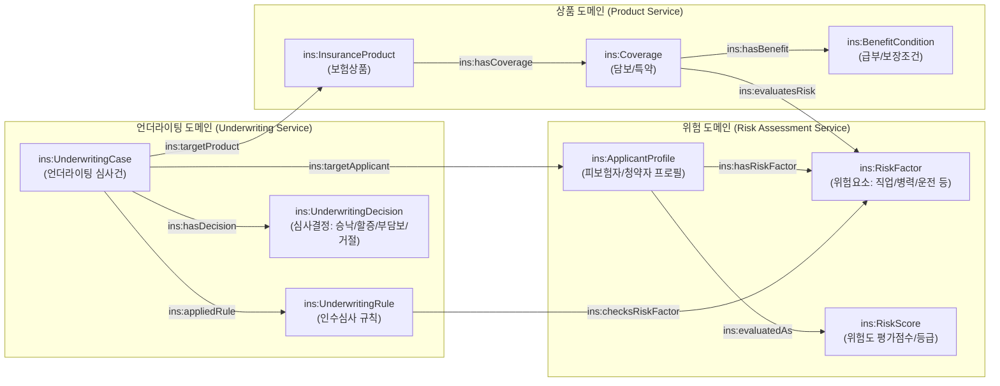
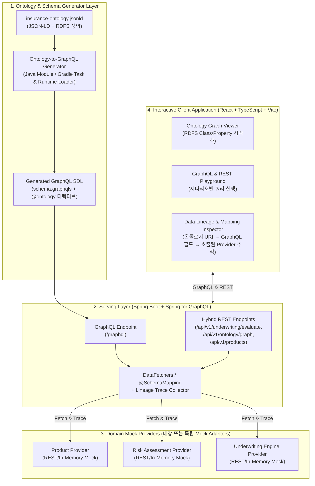
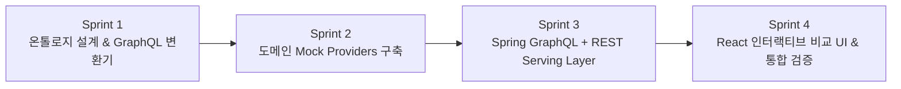

# Ontology → GraphQL Schema 실증 PoC 요구사항 정의서 & 스프린트 플랜

## 1. PoC 개요 및 목적 (Executive Summary)

보험사의 핵심 비즈니스 지식인 **상품(Product) · 언더라이팅/심사(Underwriting) · 위험(Risk)** 도메인을 **JSON-LD / RDFS 기반 온톨로지(Ontology)**로 표준화하여 정의하고, 이로부터 **GraphQL Schema(SDL)**를 체계적으로 도출합니다. 도출된 스키마를 기반으로 분산된 도메인 마이크로서비스(Mock Providers)를 통합 서빙하는 **Spring for GraphQL 기반 Serving Layer(하이브리드 GraphQL + REST API 게이트웨이)**와, 온톨로지 그래프·GraphQL 쿼리·데이터 계보(Lineage)를 나란히 비교·검증할 수 있는 **React 인터랙티브 클라이언트 애플리케이션**을 구축하여 **Ontology-Driven API Architecture**의 실효성을 입증합니다.

> [!IMPORTANT]
> **핵심 실증 포인트 (Wow Point)**
> 1. **Single Source of Truth (SSOT)**: JSON-LD/RDFS 온톨로지 정의에서 GraphQL 스키마(`*.graphqls`)와 시맨틱 디렉티브(`@ontologyClass`, `@ontologyProperty`, `@sourceService`)가 일관되게 도출됨을 증명합니다.
> 2. **복잡한 보험 도메인 관계의 단일 그래프 탐색**: 상품 구조, 가입 담보, 피보험체 위험 요소(Risk Factor), 언더라이팅 룰 및 심사 결과를 여러 레거시/도메인 서비스 호출 없이 단일 쿼리로 조합합니다.
> 3. **시각적 검증 (Visual Lineage & Graph Comparison)**: UI에서 **온톨로지 개념 그래프(RDFS Class/Property)** ↔ **도출된 GraphQL Schema** ↔ **실행된 GraphQL/REST 응답 및 마이크로서비스 호출 계보(Data Lineage)**를 한 화면에서 나란히 비교합니다.

---

## 2. 타겟 보험 도메인 및 온톨로지 모델링 (Domain Scope)

**보험 상품(Product) & 언더라이팅(Underwriting) & 위험(Risk)** 3대 도메인을 중심으로 JSON-LD (`@context`, `@graph`) 및 RDFS (`rdfs:Class`, `rdf:Property`, `rdfs:domain`, `rdfs:range`, `rdfs:subClassOf`) 스키마로 정의합니다.

### 2.1 주요 온톨로지 클래스 (`rdfs:Class`) 및 관계 (`rdf:Property`)



| 도메인 영역 | 온톨로지 클래스 URI (`ins:*`) | 주요 속성 (`rdf:Property`) | 매핑될 도메인 서비스 (Mock Provider) |
| :--- | :--- | :--- | :--- |
| **상품 (Product)** | `ins:InsuranceProduct`, `ins:Coverage`, `ins:BenefitCondition` | `productCode`, `productName`, `productCategory`, `basePremium`, `maxInsuredAmount`, `hasCoverage` | **Product Mock Provider** (상품/담보 카탈로그 시스템) |
| **위험 (Risk)** | `ins:ApplicantProfile`, `ins:RiskFactor`, `ins:MedicalRisk`, `ins:OccupationalRisk`, `ins:RiskAssessment` | `occupationGrade`, `smokingStatus`, `preExistingConditions`, `riskGrade`, `riskScore`, `loadingRate` | **Risk Mock Provider** (위험평가/스코어링 시스템) |
| **언더라이팅 (UW)** | `ins:UnderwritingCase`, `ins:UnderwritingRule`, `ins:UnderwritingDecision` | `caseId`, `uwStatus`, `decisionType`(`ACCEPTED`, `SUBSTANDARD_LOADING`, `EXCLUSION`, `DECLINED`), `appliedRules`, `surchargePremium`, `exclusionClauses` | **Underwriting Mock Provider** (인수심사/룰엔진 시스템) |

---

## 3. 시스템 아키텍처 (System Architecture)



---

## 4. 상세 기능 요구사항 (Functional Requirements)

### FR-1. JSON-LD / RDFS 온톨로지 정의 및 GraphQL 스키마 도출기
- **FR-1.1 (JSON-LD/RDFS 스키마 작성)**: 보험 상품, 위험, 언더라이팅 도메인의 클래스(`rdfs:Class`), 계층구조(`rdfs:subClassOf` 또는 인터페이스 매핑), 데이터 속성 및 객체 관계 속성(`rdf:Property`, `rdfs:domain`, `rdfs:range`), 그리고 원천 시스템 매핑 메타데이터(`ins:sourceService`, `ins:sourceEndpoint`)를 포함한 `insurance-ontology.jsonld` 파일을 정의합니다.
- **FR-1.2 (Ontology → GraphQL 변환 엔진)**:
  - `rdfs:Class` → GraphQL `type` 및 `interface` (상속 관계 존재 시)로 자동 변환
  - `rdf:Property` (Literal range: `xsd:string`, `xsd:int`, `xsd:decimal`, `xsd:boolean`) → GraphQL 스칼라 필드로 변환
  - `rdf:Property` (Object range: 다른 `rdfs:Class`) → GraphQL 객체 참조 필드로 변환
  - 커스텀 GraphQL 디렉티브 자동 부착:
    ```graphql
    directive @ontology(uri: String!, label: String, rdfsClass: String, sourceService: String, sourceEndpoint: String) on OBJECT | FIELD_DEFINITION | INTERFACE
    ```
- **FR-1.3 (실시간 변환 프리뷰)**: UI에서 온톨로지 JSON-LD에 새로운 프로퍼티나 클래스를 추가/수정해 시뮬레이션하면 즉시 변환된 GraphQL SDL diff를 확인할 수 있는 API(`POST /api/v1/ontology/transform-preview`)를 제공합니다.

### FR-2. 도메인별 서비스 Provider Mocking
- **FR-2.1 (3개 도메인 Mock Providers)**:
  1. **Product Service Mock** (`/mock/product-service/**`): 종합건강보험, 간편고지보험, 운전자보험 등 상품/담보/가입한도 정보 제공
  2. **Risk Service Mock** (`/mock/risk-service/**`): 청약자/피보험자의 직업급수(1~3급), 흡연여부, 기왕증(고혈압, 당뇨 등) 기반 위험점수 및 위험등급 산출 데이터 제공
  3. **Underwriting Service Mock** (`/mock/uw-service/**`): 심사 케이스 현황, 적용된 인수심사 룰(예: 고혈압+당뇨 시 특정 담보 부담보 또는 할증), 최종 심사 결정(승낙/할증/부담보/거절) 및 시뮬레이션 수행
- **FR-2.2 (호출 로깅 및 지연시간/출처 태깅)**: 각 Mock Provider가 호출될 때 어떤 엔드포인트에서 어떤 원천 필드명으로 응답했는지 **Execution Lineage Trace** 정보를 수집합니다.

### FR-3. Spring for GraphQL + REST 하이브리드 Serving Layer
- **FR-3.1 (GraphQL 통합 서빙)**:
  - `@BatchMapping` / `@SchemaMapping`을 활용해 `UnderwritingCase` 조회 시 연관된 `InsuranceProduct`(`Product Service`), `ApplicantProfile` & `RiskFactor`(`Risk Service`), `UnderwritingDecision`(`UW Service`)을 조합하여 단일 응답으로 반환합니다.
  - GraphQL 응답의 `extensions.lineage` (또는 별도 트레이스 필드)에 **각 GraphQL 필드가 어느 온톨로지 URI(`ins:*`)에서 유래했고, 어느 Mock Provider 엔드포인트를 호출해 조립되었는지** 계보 메타데이터를 함께 내려줍니다.
- **FR-3.2 (하이브리드 REST API 제공)**:
  - 레거시 채널이나 외부 파트너 연동을 가정하여 일부 핵심 API는 REST API로도 동시 제공합니다.
  - `GET /api/v1/products` (상품 목록 및 담보 조회)
  - `POST /api/v1/underwriting/simulate` (청약자 위험 프로필 입력 시 언더라이팅 심사 결과 즉시 시뮬레이션)
  - `GET /api/v1/ontology/schema` (원본 JSON-LD 온톨로지, 파싱된 그래프 노드/엣지, 도출된 GraphQL SDL 반환)

### FR-4. 인터랙티브 클라이언트 애플리케이션 (React UI)
- **FR-4.1 (3-Pane 인터랙티브 비교 워크스페이스 - 핵심 화면)**:
  - **Left Pane (Ontology Graph View)**: JSON-LD/RDFS의 클래스와 프로퍼티 관계를 인터랙티브 노드-엣지 그래프로 시각화. 특정 클래스/프로퍼티 클릭 시 상세 RDFS 메타데이터 표시.
  - **Center Pane (Derived GraphQL Schema & Query Runner)**: 온톨로지에서 도출된 GraphQL SDL 뷰어(`@ontology` 디렉티브 포함) + 시나리오 프리셋 기반 GraphQL Query / REST API 실행기.
  - **Right Pane (Response & Live Data Lineage View)**: 쿼리 실행 결과 JSON과 함께, 응답의 각 데이터가 **[Ontology Concept (`ins:*`)] → [GraphQL Field] → [Mock Provider REST Call (`/mock/...`)]**로 어떻게 흘러왔는지 시각적 데이터 계보(Lineage) 다이어그램 및 타임라인으로 표시.
- **FR-4.2 (언더라이팅 심사 & 리스크 시뮬레이터 뷰)**:
  - 비즈니스 사용자 관점에서 피보험자 조건(직업급수, 병력, 가입희망 상품)을 변경하며 GraphQL Mutation/Query 및 REST API를 호출하고, 그 결과로 인수심사 판정(표준체 승낙, 할증 승낙, 특정부위 부담보, 거절)이 어떻게 달라지는지 직관적으로 체험하는 화면.
- **FR-4.3 (Ontology 진화 실증 뷰 - Schema Evolution Demo)**:
  - 예: 온톨로지에 새로운 위험요소 속성(예: `ins:geneticRiskScore` 또는 `ins:drivingHabitScore`)을 추가했을 때 GraphQL SDL이 어떻게 자동 확장되는지 비교 시연.

---

## 5. 비기능 및 기술 스택 요구사항 (Technical Stack)

| 구분 | 기술 스택 | 비고 |
| :--- | :--- | :--- |
| **Ontology Format** | JSON-LD 1.1 + RDFS (`rdfs:Class`, `rdf:Property`, `xsd:*`) | 표준 시맨틱 웹 어휘 + 보험 도메인 네임스페이스(`ins:`) |
| **Backend / Serving Layer** | **Java 21**, **Spring Boot 3.x**, **Spring for GraphQL**, Spring Web MVC | 단일 멀티패키지 또는 멀티모듈 구조로 간편 실행 지원 |
| **Mock Providers** | Spring Boot 내장 독립 Mock Controller (`/mock/product/**`, `/mock/risk/**`, `/mock/uw/**`) + WebClient/RestClient 연동 | 실제 HTTP 호출 및 트레이스 헤더/계보 추적 재현 |
| **Frontend UI** | **React 18+**, **TypeScript**, **Vite**, **Tailwind CSS**, **Lucide Icons** | 인터랙티브 그래프 시각화 및 Split-pane 비교 UI |

---

## 6. 스프린트 플래닝 (Sprint Planning)

PoC를 빠르고 체계적으로 완성하기 위해 4개의 스프린트(마일스톤)로 나누어 진행합니다.



### Sprint 1: 보험 도메인 JSON-LD/RDFS 온톨로지 정의 및 GraphQL Schema 변환기 구현
- **목표**: 상품·위험·언더라이팅 온톨로지(`insurance-ontology.jsonld`) 작성 및 Java 기반 `OntologyToGraphQLGenerator` 구현
- **주요 산출물**:
  - `insurance-ontology.jsonld` (클래스 8종 이상, 프로퍼티 25종 이상, 도메인 서비스 매핑 어노테이션 포함)
  - JSON-LD/RDFS 파서 및 GraphQL SDL 생성 엔진 (`@ontology` 디렉티브 포함 `schema.graphqls` 도출)
  - 변환기 단위 테스트 (온톨로지 입력 → 유효한 GraphQL SDL 생성 검증)

### Sprint 2: 3대 보험 도메인 Mock Providers 구현 (Product, Risk, Underwriting)
- **목표**: 실제 보험사의 차세대/레거시 도메인 마이크로서비스를 모사하는 3개의 Mock Provider 구축 및 풍부한 샘플 데이터(현실적인 한국형 보험 상품/담보/심사 룰) 적재
- **주요 산출물**:
  - `ProductMockProvider`: 무배당 시그니처 건강보험, 간편심사 유병자보험, 스마트 운전자보험 및 각 특약/담보 데이터
  - `RiskMockProvider`: 청약자별 위험 프로필(고혈압, 당뇨, 위험직종 등), 위험등급 산출 로직
  - `UnderwritingMockProvider`: 심사 케이스 조회, 룰 매칭 결과(할증률, 부담보 부위, 인수거절 사유) 및 심사 시뮬레이션 엔진

### Sprint 3: Spring for GraphQL Serving Layer & Hybrid REST API + Lineage Tracer 구현
- **목표**: 도출된 GraphQL 스키마를 구동하고, 분산된 3개 Mock Provider를 조합하는 `@SchemaMapping` 리졸버와 REST API, 그리고 데이터 계보 추적기(Lineage Collector) 구현
- **주요 산출물**:
  - GraphQL Query / Mutation 리졸버 (`UnderwritingController`, `ProductController`, `RiskController`)
  - Hybrid REST API 엔드포인트 (`/api/v1/ontology/**`, `/api/v1/underwriting/**`, `/api/v1/products/**`)
  - 쿼리 실행 시 **[Ontology URI ↔ GraphQL Field ↔ Backend Mock API Call (소요시간, 원천필드)]** 매핑 트레이스를 수집하여 응답에 포함시키는 인터셉터/트레이서

### Sprint 4: React 인터랙티브 클라이언트 애플리케이션 (Ontology ↔ GraphQL ↔ Lineage UI) 및 통합 테스트
- **목표**: 이해관계자에게 Wow Point를 전달할 수 있는 시각적 대시보드 및 인터랙티브 시연 UI 개발
- **주요 산출물**:
  - **Ontology ↔ GraphQL ↔ Lineage 3-Pane Explorer**: 온톨로지 그래프 노드를 클릭하면 연결된 GraphQL 타입/필드와 실제 호출된 Mock 서비스 계보가 하이라이트되는 인터랙티브 화면
  - **Underwriting Sandbox**: 피보험자 위험 조건과 상품을 선택해 실시간 인수심사를 실행(GraphQL vs REST 비교 가능)하는 시뮬레이터
  - **Ontology Schema Evolution Lab**: JSON-LD 온톨로지에 속성을 추가하면 GraphQL 스키마가 자동 도출되는 실시간 변환 체험 화면
  - End-to-End 통합 구동 및 검증 완료
